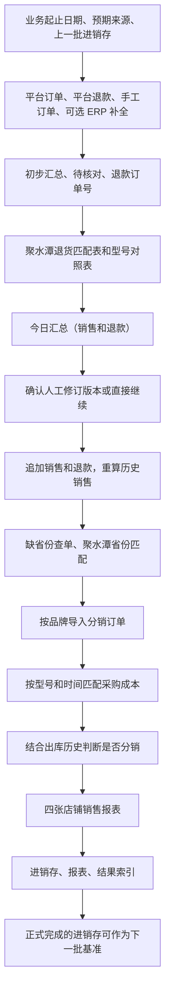

# SJH-DATA 重构前数据与业务逻辑审计

审计日期为 2026-11-27。供用户、Antigravity 和 Codex 确定首批重构的业务范围、数据契约和验收样本。

## 结论

- **首选用一个店铺、一个业务日验证销售明细。** 拼多多直出与聚水潭样本有足够多的重叠记录，适合在小范围内验收两种来源的优先级、店铺与型号归属、重复导入及销售金额。如果首要目标是交付报表，可以直接从现有进销存汇总样本验收四张输出表。两种切入点见第四章。
- **Phase 1 的 GMV、Refund Amount、Net Sales 和 Units Sold 不能直接替换现用的销售额、资金日期退款、实际销额和实际销量。** Phase 1 按订单行计算，把退款归到该行的下单或付款时间。旧流程按销售和退款各自的业务时间取数，再让退款回查历史销售，计算净量、净额和采购成本。
- **基础信息表可作为首批匹配输入，部分键需要增加来源或上下文。** 产品表有 173 个标准型号和 39 组一内一外机。同一聚水潭商品或 SKU 编码可指向多个型号。店铺表有 38 家店。“混合”销售模式的店铺仍需要逐单认定经销与分销。
- **旧报表和进销存应作为两种交付结果验收。** 《现有数据汇总表》五张表保存了加工后的值。旧模板保存店铺报表公式，采购和历史退款规则来自旧代码。汇总样本的“小额补偿”与旧代码的“补贴”计算分支相符，名称需确认。

### 范围与核验方法

本次核验包括 [DATA-INFO](E:/01work/DATA-INFO) 的全部 9 个文件、[Summary-of-Work-Data](E:/01work/SJH/自动化脚本/Summary-of-Work-Data) 的说明、配置、模板、入口、核心代码和关键测试，以及 Phase 1 的术语、契约和当前工作区实现。基线为 Git `f9f9012` 及工作区当时已有的 `backend/app/seed.py` 差异。该差异只改了重复初始化状态字典时的无变化更新列。解析探针按工作区种子常量运行，数据库当前的模板、店铺和状态配置未读取。

Excel 用 openpyxl 3.1.5 检查工作表、表头、合并区域、数据类型和记录数。汇总表和输出模板分别用 `data_only=False` 读公式、用 `data_only=True` 读保存值，并核对 OOXML 的公式节点。CSV 用严格解码和逗号分隔逐条统计。行数按有值数据行计，表头、仅格式区域和空白行另列。连接统计去两端空白、Excel 订单号包装和首引号，必要时解码 Excel 字符转义并做大小写无关的精确匹配。该规范化用于核验候选字段。

Phase 1 用真实文件在内存执行 `parse_upload` 和 `clean_sheet`，四个无店名的直出样本各给一个匿名默认店。ERP B 用店铺表的全量名称与平台作候选绑定。探针结合静态源码和纯函数实测，未连接 MySQL、启动 Web UI、运行 COM 或执行完整业务批次。旧报表用现有汇总样本和原模板在内存生成 xlsx，再读回核对。报告保留结构、计数、公式与少量构造示例。

## 一、数据资产盘点

### 1.1 产品基础信息

[产品基础信息.xlsx](E:/01work/DATA-INFO/基础信息/产品基础信息.xlsx) 共 4 张可见表。表头均为第 1 行，业务字段都是文本。下表键的唯一性以本文件的检查结果为限。

| Sheet | 可见范围及数据行 | 按列排列的表头 | 键、空值与关联 |
|---|---|---|---|
| 产品分类 | A1:G189，实际业务数据 A1:C14，13 行 | 业务板块、品类、品牌 | `品类 + 品牌` 13 组均唯一并对应一个业务板块。8 个品类在样本中各只对应一个业务板块。3C 含电脑、手机，家电含空调、电视、冰箱、冰柜、热水器、燃气灶。 |
| 产品型号 | A1:C174，173 行 | 品类、品牌、型号 | 173 个型号均非空且唯一。按 `品类 + 品牌` 关联分类表，173/173 命中。9 个品牌为奥克斯、海信、华凌、科龙、美的、美菱、苹果、软通、长虹。 |
| 产品内外机 | A1:D79，78 行 | 型号、内外机型号、内外机分类、映射值 | 39 个整机型号各对应 1 个内机和 1 个外机。`内外机型号` 和 `型号 + 内外机分类` 分别唯一。78/78 行整机型号命中产品型号。D 列 27 个非空文本、51 个空白，非空项分布为内机 15、外机 12，带括号、全角符号或编号等写法。 |
| 产品ID匹配 | A1:H271，270 行 | 型号、jst_i_id、jst_sku_id、pdd_sku_id、tb_sku_id、tm_sku-id、dy_sku_id、jd_sku_id | 270/270 行型号命中产品型号，覆盖 173 个不同型号。33 个型号出现多行。113 行所有来源 ID 都为空，仍保留型号。 |

`产品ID匹配` 的各列只在各自的标识范围内检验。匹配列的空值和冲突决定哪些行可以自动归到单一型号。

| 字段 | 非空行 / 不同 ID | 空白行 | 指向多个型号的 ID 数 | 型号反向关联特点 |
|---|---:|---:|---:|---|
| jst_i_id | 156 / 51 | 114 | 5，单个 ID 最多 4 个型号 | 59 个型号有值，各有 1 个 ID |
| jst_sku_id | 156 / 55 | 114 | 3，单个 ID 最多 3 个型号 | 59 个型号有值，各有 1 个 ID |
| pdd_sku_id | 82 / 81 | 188 | 1，指向 2 个型号 | 22 个型号有值，17 个有多个 ID |
| tb_sku_id | 1 / 1 | 269 | 0 | 1 个型号有值 |
| tm_sku-id | 42 / 42 | 228 | 0 | 18 个型号有值，13 个有多个 ID |
| dy_sku_id | 25 / 25 | 245 | 0 | 6 个型号均有多个 ID |
| jd_sku_id | 32 / 32 | 238 | 0 | 15 个型号有值，14 个有多个 ID |

`jst_i_id + jst_sku_id` 同时有值的 156 行构成 55 组键，仍有 3 组多型号冲突。`型号` 可作为本次校验的标准键，正式关联仍需确认业务唯一性。遇到冲突时，应保留订单来源、原 ID 字段和所有候选，等业务确认区分条件。D 列“映射值”的使用优先级也需确认。旧脚本读取另一份“型号对照表”，字段布局和使用方式见 2.4。

文件提供分类、品牌、型号、内外机关系和多渠道 ID 对照。Sheet 中没有独立的 SKU/SPU 主键约定、通用“商家编码”或“商品名称”、独立“规格”、采购成本、套装计量系数或生效日期字段。现有结构能证明 39 组内外机关系。3C 全名中的容量和颜色属于业务区分信息，旧流程对此有专门保留规则。各 `*_sku_id` 与实物文件的对应关系见 1.5。 [产品基础信息.xlsx](E:/01work/DATA-INFO/基础信息/产品基础信息.xlsx)

### 1.2 店铺基础信息

[店铺基础信息.xlsx](E:/01work/DATA-INFO/基础信息/店铺基础信息.xlsx) 共 5 张可见表，均从第 1 行起表头，全部为文本。

| Sheet | 范围 / 数据行 | 按列排列的表头 | 键和关系 |
|---|---:|---|---|
| 运营方与平台 | A1:B11 / 10 | 运营方、平台 | `运营方 + 平台` 唯一。代运营配抖音、京东、拼多多、淘宝、天猫，自运营配焕新生活、京东、拼多多、淘宝、天猫。 |
| 主体 | A1:A9 / 8 | 主体 | 8 个不同经营主体供店铺引用，单个主体最多对应 12 家店。 |
| 销售模式 | A1:A4 / 3 | 销售模式 | 经销、分销、混合。 |
| 店铺状态 | A1:A4 / 3 | 状态 | 启用、休眠、未启用。 |
| 店铺信息 | A1:F39 / 38 | 店铺名称、运营、平台、主体、销售模式、状态 | 店铺名称单列和 `平台 + 店铺名称` 在样本中均唯一。`运营 + 平台`、主体、状态均 38/38 命中字典。23 个有销售模式的店铺均命中字典。 |

38 家店按平台分布为拼多多 17、天猫 8、淘宝 7、京东 4、抖音 1、焕新生活 1。16 家代运营、22 家自运营。状态为启用 18、休眠 5、未启用 15。销售模式为经销 10、分销 7、混合 6、空白 15，空白均来自未启用店。店铺级模式“混合”表达该店可有两类销售，订单级“是否分销”仍需要订单或业务规则证据。表中没有独立负责人、渠道编码、店铺别名、品牌、报表汇总归属或状态生效日期字段。“运营方”在本文件是代运营或自运营的分类。 [店铺基础信息.xlsx](E:/01work/DATA-INFO/基础信息/店铺基础信息.xlsx)

旧模板另有 `店铺 + 品牌 → 运营方` 配置。模板的 24 组覆盖 21 个店名，1 个组的店名在店铺主数据没有精确命中，其余各组的运营分类均一致。汇总样本 26 行销售与 25 行退款均能按店名命中店铺表。ERP B 的 25,115 行也全部命中两家店。天猫导出的“分销商店铺名称”只有一个值，未精确命中店铺表，旧脚本将该来源固定归入“天猫优品”。该别名关系需要确认。 [店铺销售输出模板.xlsx](E:/01work/SJH/自动化脚本/Summary-of-Work-Data/模板/店铺销售输出模板.xlsx)

### 1.3 现有数据汇总表

[现有数据汇总表.xlsx](E:/01work/DATA-INFO/现有数据汇总表.xlsx) 有 5 个可见 Sheet，均为首行平铺表头，合并单元格、透视表、图表和外部工作簿公式链接均为 0。销售和退款表冻结第 1 行。分销页为历史明细和匹配来源，保留不同系统的导出布局。宽表的原始字段顺序见附录 A。

| Sheet | 布局、表头与粒度 | 关键维度与度量 |
|---|---|---|
| 店铺销售汇总 | A1:S27，26 行。A:M 为销售和退款结果，N:P 为省市区，Q:S 为采购与分销。A 列在样本内唯一。 | A:G 订单号、店铺、型号、时间、销量、销售额、品牌。H:M 退款数量、退款金额、实际销量、实际销额、退款状态、备注。N:S 省份、城市、区县、采购单价、采购总价、是否分销。 |
| 退款数据 | A1:I26，25 行。A 列样本内唯一，与销售表订单号交集 4 个。 | A:I 订单号、店铺、型号、时间、退款数量、销售额、退款金额、品牌、出库状态。金额 F 和 G 分别对应原销售额和本次退款额。D 为退款时间。 |
| 华凌分销销售汇总 | A1:CU37，36 行、99 个表头，A1:CU37 筛选，冻结 A2。B 列平台订单号 36 个均唯一。 | B 平台订单号、C 平台状态、D 零售订单号、E:F 下单/支付、H 实际发货方式、I 订单状态、U 店铺名称、AT 零售订单行号、AX 商品编码、AZ 套装商品编码、BB 品牌名称。AK:AQ 为整单金额和补贴，BI:BN 为商品销售数量、单价、分摊、实付、运费、总价。CT:CU 为代发字段。 |
| 科龙分销销售汇总 | A1:AA26，25 行、27 个物理列。K 表头及数据均空，Q 表头为空白字符且下方有数据。筛选范围 A1:J26，线上订单号 P 在筛选之外且 25 个均唯一。 | A 内部订单号、B 店铺、C:D 标准商品名/商品名称、F 数量、G 应付金额、H 发货日期、I 状态、J 更新状态、L 付款日期、M 平台站点、N 已付金额、O 下单时间、P 线上订单号、R:S 快递单号/商品编码、T:U 型号/规格、V:AA 商品单价、商品金额、原组合装商品编码、登记数量、实退数量、订单退款金额。 |
| 美的分销销售汇总 | A1:CS53，52 行、97 个表头，A1:CS53 筛选，冻结 A2。B 平台订单号 52 个均唯一。 | B、D、H、I、AT、AX、BB 及整单与商品行字段和华凌用途相同。无 CT:CU 代发列。“风控原因”在 CS，华凌在 BP，后段需要按字段名对齐。 |

**公式核验。** 五张表在 `data_only=False` 均未读到公式单元格，底层 XML 的 `<f>` 计数依次是 0、0、0、0、0。`data_only=True` 取到保存的静态值。销售、退款的订单号均为文本，D 为 Excel 日期时间，数量为整数，金额和成本为整数或浮点数值，销售备注 M 在 26 行均空。分销宽表的日期同时有 Excel 日期和文本字段，订单关联优先取已验证的文本列。分销三表的查单列与 26 行销售样本无交集，无法由本文件复算 S 列的分销判定。

- `K = F − I` 和 `R = Q × J` 用 Decimal 对 26 行逐一复算，在半分容差内 26/26 相符。
- L 列为“小额补偿”10、“部分退款”7、“未退款”9。10 行小额补偿均满足 `0 < I ≤ 500` 且 `J = E`。另外 16 行满足 `J = MAX(E − H, 0)`。把“小额补偿”视为旧代码“补贴”的同一计算分支后，历史退款脚本的 J/L 规则与 26/26 行相符。构造例子，销量 2，退款数量 1，销售额 1,000 元，退款 80 元时，按该分支实际销量 2、实际销额 920 元。
- 销售 S 列已有“否”24、“是”2。退款表 I 列 25 行均为“已发货”。华凌、美的样本共 88 行均为“零转采”，其中“换货订单(线上订单)”分别为 8、12 行。科龙 25 行均为“已发货”，平台站点为拼多多，更新状态为空。退款样本的 25 行型号有 23 行精确命中产品型号表，销售为 26/26。
- 样本里没有“采购汇总”页。采购日期选择、首笔退款的跨日归属和取消退款的先参与后删除，都需从旧脚本、测试与业务确认追溯。现有汇总样本与旧模板之间没有可自动刷新的工作簿链接。对照字段及输出公式见 2.8。 [进销存退款代码](E:/01work/SJH/自动化脚本/Summary-of-Work-Data/scripts/inventory_refunds.py:120)

这份工作簿体现出三个实际任务。第一是逐单复核退款、有效销量、实际销额和成本。第二是维护经销分销归属与分销订单证据。第三是以加工后的 J/K/R/S 生成按店铺、品牌及运营方看的日/批和累计报表，以及品牌经销采购差额和地区销量销额。按原始订单金额做的平台合计不足以回答这些问题。

### 1.4 六个平台订单文件

原始表头都在第 1 行。四个 xlsx 均可直接解析为 OOXML，各一个可见 Sheet。两个 CSV 都是带 BOM 的 UTF-8（`utf-8-sig`）、逗号分隔，每条业务记录字段数一致。日期范围只描述样本，各平台覆盖日期和店铺有差别。表头全列见附录 A。

| 文件 | Sheet / 数据规模 | 订单与产品列 | 业务日期及地区 |
|---|---|---|---|
| 淘宝订单.xlsx | `export`，37,087 行 × 37 列 | A 子订单编号、B 主订单编号，两列均非空且各自样本内唯一。C 商品标题、F 外部系统编号、G 商品属性、K 商家编码、T 商品ID。商品ID 只有 1 个不同值。无店名字段。 | Q 创建、R 付款、Y 发货、AK 确认收货。创建和可用付款日期 2026-10-17 至 2026-11-14，付款缺 11,564 行。无单独省/市/区列。 |
| 天猫订单.xlsx | `全部数据导出`，1,030 行 × 78 列 | L 系统单号 1,030 个唯一，O 交易订单号和 P 外部订单号全非空、逐行同值，各 1,028 个。N 发货LP号 647 个非空且均以 LP 开头并唯一。BG 分销订单号。AU 货号全空，AV 货品编码、AW 商品编码均 42 个不同值，AX 商品名称。外部单号 + 商品编码样本内唯一。A 店铺名称整列空，BD 分销商店铺名称齐全且只有一种。 | D 下单、E 支付、F 发货、G 签收。下单及付款齐全，日期 2026-08-01 至 2026-11-23。V:X 省、市、区有值分别为 1,030、1,027、1,014 行。 |
| 抖音订单.csv | CSV，803 行 × 73 列，逻辑表名 `Sheet1` | 主订单编号 802 个，子订单编号 803 个且唯一。选购商品、商品规格、商品ID、商家编码、所属门店ID。主/子订单号、商品ID、规格和商家编码在每行都含制表符。无店铺名称。 | 订单提交、支付完成、发货、订单完成时间。订单提交 2026-08-01 至 2026-11-21，支付有 170 行、缺 633 行。省、市、区均齐全，省有 25 个不同值。 |
| 京东订单.xlsx | `Sheet1`，1,765 行 × 77 列 | A 订单号 892 个，871 个订单多行、共 1,744 行。B 商品ID 32 个，与订单号组合唯一。AD 货号、AT 门店名称均空，AL 商家SKUID 有值 1,743 行。无子单号。 | F 下单、AC 付款确认、AZ 订单出库、AE 订单完成。下单 2026-08-01 至 2026-11-23。支付缺 14、出库缺 397。有门店地址及邮编类表头，缺独立的订单省市区列。 |
| 拼多多订单.csv | CSV，96,689 行 × 27 列，逻辑表名 `Sheet1` | 订单号非空且样本内唯一。商品id 31 个、样式ID 34 个，二者全含制表符。商家编码-规格维度及商品维度均有 96,490 行非空、各 12 个不同值。无子单号、店名或省市区列。 | 订单成交时间、发货时间、确认收货时间，成交有 53,228 行（2026-08-26 至 2026-11-24），缺 43,461 行且均具有可提取日期的订单号前缀。该前缀只能提供推导日期。 |
| 聚水潭订单.xlsx | `Sheet1`，25,115 行 × 76 列 | 内部订单号为数字，25,115 个唯一。线上订单号及原始线上订单号各有 25,084 个不同文本值。31 个线上订单各两行，线上子订单编号 25,111 个非空且唯一，4 行可看备用“子订单编号”。10,916 个线上子订单号符合脚本判定的合成格式。外部交易单号全空。店铺名称有两种。 | 下单、付款日期、发货日期、确认收货时间及物流签收时间。下单齐全，2026-10-26 至 2026-11-25，付款缺 45，物流签收时间全空。省份/城市各有 22,108 行，区县 22,107 行。 |

| 文件 | 状态枚举与行数 | 金额、数量、退款及模板影响 |
|---|---|---|
| 淘宝 | 订单状态为交易成功 19,001、交易关闭 17,564、卖家已发货，等待买家确认 493、买家已付款,等待卖家发货 29。退款状态为没有申请退款 30,775、退款成功 6,115、退款关闭 181、卖家拒绝退款 9、卖家已经同意退款，等待买家退货 5、买家已经申请退款，等待卖家同意 2。 | D 商品价格、E 购买数量、M 买家应付货款、N 买家实付金额、P 退款金额、AI 百亿补贴超链订单信息、AJ 超链半托管订单信息。N 有 30 行正值、25,493 行为零、11,564 行空。25,493 个已付款零金额行能从 AI 提取供货单价。P 的正额只有 30 行，其余为零或“没有申请退款”行的占位。淘宝模板能匹配。Phase 1 补金额并对状态推算退款，订单表缺退款资金日期。 |
| 天猫 | 状态为已签收 636、关闭 383、已出库 6、已揽收 5。退款“是”459、“否”571。赠品标识全为非赠品，订单类型全为销售单。 | AC 订单金额、AD 商品总售价、AG 应收金额、AH 实收金额、AM 采购价、AO 退款标志、AQ 订货数量、AS 商品小计、BH 实发数量。AH、AS、AM 全为正值，AD/AG 全为零。缺数字退款金额及退款日期。表头触发 ERP A，Phase 1 `tmall_orders` 的淘宝格式字段缺失。 |
| 抖音 | 已关闭 696、已完成 107。售后状态 `-` 734、退款成功 53、已全额退款 10、售后关闭 6。订单类型全为普通订单。 | 商品数量、商品单价、订单应付金额、运费、优惠总金额和平台/商家/达人承担优惠。803 行订单应付都为正，含未付款的关闭单。订单样本无独立退款金额和到账时间。销售过滤及售后处理差别见 2.2–2.3。 |
| 京东 | 完成 1,318、等待确认收货 40、(删除)等待出库 305、(删除)暂停 62、(删除)等待确认收货 26、(删除)延迟付款确认 12、(删除)货到付款退货 2。 | D 订购数量、G 京东价、H 订单金额、I 商家应收、K 应付金额、AB 运费金额、BW 采购价。I 有 1,485 行附金额说明，I 和 K 清洗后 298 行不等。871 个多行订单都含外机和零价行，订单内 I 重复。Phase 1 按 I 分摊，旧脚本取 K 并合并成整机候选。采购价全空，无专列退款金额。 |
| 拼多多 | 已取消 43,459、已收货 28,858、未发货，退款成功 22,247、已发货，待收货 1,309、已发货，退款成功 519、已收货，退款成功 59、待发货 236、待付款 2。售后为无售后或售后取消 73,846、退款成功 22,825、售后处理中 18。 | 商品总价、邮费、店铺/平台优惠折扣、多多支付立减、用户实付、商家实收、商品数量。商家实收与用户实付不同有 20,034 行，所有记录均保留正的实付/实收栏，包括未成交单。订单样本无退款金额与成功退款时间。Phase 1 以订单号前缀推时间并留订单行，旧脚本缺成交时间即跳过。 |
| 聚水潭 | 状态为已发货 19,555、取消 5,165、异常 233、发货中 160、待付款 2。子订单状态为已发货 12,182、取消 5,163、线上发货 2,933、发货后取消 340、空 4,406、文本 `None` 91。退款状态为未申请退款 19,479、成功退款 5,460、退款关闭 160、等待退款 16。订单类型普通 25,073、补发 42，是否赠品全为否，平台站点为淘宝天猫 14,173 行、拼多多 10,942 行。 | 数量、商品单价/商品金额、商品总成交金额、应付金额、已付金额、买家实付/卖家实收及别名、订单退款金额、政府/平台补贴、运费、分销结算金额、登记/实退数量。卖家实收与买家实付有 8,202 行不等，46 行卖家实收为 0，其中 2 行已付金额非零。订单退款金额 5,563 行为正，实退数量全为 0。Phase 1 ERP B 记录行上退款金额，旧流程用这类 ERP 表补字段或按人工登记的来源取销售，资金退款另行采集。 |

### 1.5 跨文件关联验证

针对每个候选字段做文本精确匹配。“命中”指主数据里存在该 ID 或型号，映射为多个型号的行仍需核对。

| 来源列 | 对照列 | 命中行 / 来源非空行 | 说明 |
|---|---|---:|---|
| 京东 商品ID | jd_sku_id | 1,748 / 1,765 | 31/32 个 ID。商家SKUID 对该列命中 0/1,743，对 jst 两列分别命中 20 行。 |
| 天猫 商品编码、货品编码 | tm_sku-id | 各 1,030 / 1,030 | 42/42 个 ID。对 jst_sku_id 各只命中 179 行。 |
| 抖音 商品ID | dy_sku_id | 753 / 803 | 25/29 个 ID。商品规格精确匹配型号也是 753 行。商家编码对 jst_i_id 有 803/803 行命中，仍有主数据一对多风险。 |
| 拼多多 商品id、样式ID | pdd_sku_id | 96,465 / 96,689，0 / 96,689 | `pdd_sku_id` 在样本主要对应商品级 ID。 |
| 拼多多 商家编码-规格维度、商家编码-商品维度 | jst_sku_id、jst_i_id | 96,479 / 96,490，94,758 / 96,490 | 商品维度直接匹配型号为 94,765 行。需要保留各标识类型，并用缺失和冲突样本确定回退顺序。 |
| 淘宝 商品ID | tb_sku_id | 37,087 / 37,087 | 测到的全量行来自同一个商品 ID。商家编码对标准型号或 jst 两列均命中 0 行。 |
| 聚水潭 标准商品名、款号 | 产品型号.型号 | 12,920 / 13,091，12,912 / 25,115 | 前者还有 12,024 行空。款号对 jst_i_id 命中 12,913 行。各列独立统计，命中数不能相加。 |
| 聚水潭 商品编码、原始商品编码 | jst_sku_id | 13,091 / 25,115，11,145 / 25,115 | 店铺商品编码对该列命中 0。店铺款式编码在全 ERP 样本中对 pdd_sku_id、tb_sku_id 分别命中 10,895、14,131 行，应在已绑定的平台范围内取用。 |

与同一份聚水潭 ERP B 样本比较，拼多多 `订单号` 与 `线上订单号` 重合 10,803 个，每个重合订单都有相同的 `商品id ↔ 店铺款式编码` 候选。淘宝主订单号、子订单号各自与聚水潭线上订单号重合 13,909 个，淘宝子订单号与聚水潭线上子订单编号重合 13,906 个。另三个来源和这份 ERP B 样本的对应订单号无交集。样本内 Phase 1 真正生成的 `Line Key` 交集及保留风险见 3.3。

## 二、既有自动化的业务逻辑

旧流程目录为 [Summary-of-Work-Data](E:/01work/SJH/自动化脚本/Summary-of-Work-Data)。README 记录独立工具，销售全流程说明记录统一入口和暂停条件。此次看到的脚本自带 `数据/` 各输入目录只有 `.gitkeep`。文档引用的真实型号对照、采购台账、退货及省份匹配表、上一批进销存由运行时选入。下文按代码、配置和测试描述这些输入的契约。订单样本文件名为 `平台订单.*` 一类简写，不含旧解析器使用的 `平台-订单-`、`平台-退货-` 或 `ERP` 标记，直接放入旧入口不会自动识别。 [README](E:/01work/SJH/自动化脚本/Summary-of-Work-Data/README.md) · [销售全流程使用说明](E:/01work/SJH/自动化脚本/Summary-of-Work-Data/销售全流程使用说明.md)

### 2.1 运行顺序和模块清单

| 入口或模块 | 核心脚本 | 默认输入和产物 |
|---|---|---|
| `运行汇总.cmd/.ps1` | `continuation.ps1`、`run_pipeline.py`、`common.py`、`extract_data.py`、`daily_report.py`、`build_report.py` | `数据/待汇总`、`平台配置.json`、可选 ERP、`数据/匹配表` 的退款匹配和 `数据/基础资料` 的型号表。产出原汇总、退款订单号 TXT、有匹配表时的今日汇总。 |
| `运行进销存退款处理.cmd/.ps1` | `inventory_refunds.py/.ps1`、`province_matching.py` | `数据/进销存退款` 中一份 `0今日汇总*.xlsx` 和一份 `进-销-存汇总*.xlsx`。生成新进销存及后续省份查单名单。 |
| `运行省份匹配.cmd/.ps1` | `province_matching.py`、`inventory_refunds.ps1` | `数据/省份匹配` 中处理过的进销存和可选 `聚水潭省份匹配表*.xlsx`。生成新进销存或沿用输入，并输出缺省份名单、待核对名单。 |
| `运行分销订单汇总.cmd/.ps1` | `distribution_import.py`、`inventory_refunds.ps1` | `数据/分销订单汇总` 中的进销存、下级 `分销数据` 的 xlsx。追加到进销存内各品牌分销 Sheet。 |
| `运行采购匹配.cmd/.ps1` | `purchase_costs.py`、`inventory_refunds.ps1` | `数据/采购匹配` 中的进销存及含“采购汇总”台账。增设或更新 Q:R，准备 S 列。 |
| `运行分销匹配.cmd/.ps1` | `distribution.py`、`inventory_refunds.ps1` | 进销存的三个分销 Sheet、`数据/分销匹配` 的华凌出库表、累计经销 JSON、店铺模板、可选初始名单。填进销存 S 列并更新累计名单。 |
| `运行店铺销售汇总.cmd/.ps1` | `shop_sales_report.py` | `数据/店铺销售` 中一份进销存 xlsx、日期、`模板/店铺销售输出模板.xlsx`。生成四张报表。 |
| `运行销售全流程.cmd/.ps1` | `sales_workflow_gui.py`、`sales_setup.py`、`sales_workflow.py`、`workflow_native.ps1`、`workflow_verify.py`，调用上列 Python 模块 | 统一业务批次配置、来源清单、各步骤文件与校验、通过人工核对后续跑，生成可追溯的进销存和报表。GUI 用 Tkinter。PowerShell 命令行入口仍支持已有批次。 |
| `首次安装依赖.cmd` / `安装依赖.ps1` | `requirements.txt` | 建本机 Python 环境并安装 pandas、openpyxl、xlrd。进销存原生写入另需 Windows Excel 或 WPS。 |

### 2.2 平台提取与销售明细

**识别。** `extract_platform_data` 在输入目录第一层按文件名排序，处理 `.xlsx`、`.xlsm`、`.xls`、`.csv`，先检查禁用片段，再识别退款、销售。平台通过文件名中的 `抖音-订单-`、`京东-订单-`、`天猫-订单-`、`淘宝-订单-`、`拼多多-订单-`、`手动-订单-` 等片段选择解析器。省略店铺字段时部分平台读取无表头的辅助列 `__col2`，再从文件名的 `-订单-` 或 `-退货-` 后取店名。独立提取忽略不识别的文件，读取失败记录在来源日志和待核对。全流程对已登记为提供的禁用、未知和读取失败来源暂停。配置中的禁用片段为 `拼多多-订单-退货-华晟数码家电店`、`拼多多-华晟数码家电店`、`天猫-退货-`，ERP 候选为 `*ERP导出*.xlsx`、`*ERP*.xlsx`。 [平台配置](E:/01work/SJH/自动化脚本/Summary-of-Work-Data/平台配置.json) · [来源解析](E:/01work/SJH/自动化脚本/Summary-of-Work-Data/scripts/extract_data.py:606)

**原始值。** CSV 尝试 `utf-8-sig` 后 `gb18030`。Excel 用 openpyxl 或 xlrd，识别加密 Office 并提示先另存。源文件不携带解密参数。通用读表在前 8 行按候选表头命中最多选行，取首张可识别 Sheet，通用最低条件是至少命中一个词。重名加 `_2` 等后缀，空名用 `__colN`，删全空行并保存物理行号。手工表、型号对照、退款匹配及后续进销存另有严格表头校验。清洗删除制表符、去两端空白、把正文换行转空格。订单号以文本流转，字符串数字的 `.0` 后缀会去掉，超过 15 位的 Excel 数字 ID 被拒绝。金额去逗号、货币符号和常见占位，`Decimal` 解析后，非整数通过 `quantize(0.01)` 使用当前 Decimal 上下文（默认 `ROUND_HALF_EVEN`）再转浮点，整数原样保存。日期用 pandas 解析并输出到秒。 [common.py](E:/01work/SJH/自动化脚本/Summary-of-Work-Data/scripts/common.py:22)

| 来源 | 订单、店铺、型号 | 时间、数量、销售额 | “是否有效”的实际起始条件 |
|---|---|---|---|
| 淘宝 | 子订单编号优先，后主订单编号。店铺列或文件名。型号优先“型号”、再“商家编码”，空时可由标题提取空调型号。 | 订单付款时间、购买数量、买家实付金额 N。N 为零或无法取数时才用 AI “百亿补贴超链订单信息”中供货单价 × 数量。`0 < N < 1000` 加提示备注，金额不变。两来源均无可用金额时待核对。 | 订单状态不含“交易关闭”，退款状态不含“退款成功”。付款时间无效先跳过。 |
| 天猫 | 以 LP 开头的发货LP号优先，否则交易订单号 → 外部订单号 → 分销订单号。店铺固定“天猫优品”。型号优先“型号”，可由商品名称提取。 | 支付时间、订货数量、实收金额。付款或订单号无效则跳过。 | `状态 != 关闭` 且 `退款 != 是`。样本的分销商店铺名、系统单号及商品编码并不参与这个判定。 |
| 抖音 | 主订单编号 → 子订单编号。店铺 → `__col2` → 文件名。商品规格作型号，选购商品为产品描述。 | 支付完成时间、商品数量、订单应付金额。缺有效付款时间或订单号跳过。 | 订单状态不含“关闭”或“取消”，售后状态不含“退款成功”。代码没有把单独的“已全额退款”加到这个字符串条件，无效判定还受退款汇总回查影响。 |
| 京东 | 按已付款且有订单号的行分组。取首个商品名称不含“外机”且应付金额大于 0 的主行，否则取第一行。店铺/店铺名称或文件名。首选“型号/商品型号”，空时从商品名称抽取。 | 主行的付款确认时间、订购数量（可按商品数量、数量、订货数量取值）和应付金额。整单只保留一条主记录，采用主行数量，金额不分摊。没有独立的组件比例或套装计量。 | 同订单各行状态拼接，包含“取消”“关闭”或“删除”即无效。缺销量或销额标记待核对信息。 |
| 拼多多 | 订单号。店铺 → `__col2` → 文件名。型号优先商家编码-商品维度，空时从“商品”提取。 | 订单成交时间、商品数量(件)、商家实收金额(元)。缺成交时间直接跳过。 | 订单状态不含“取消”或“退款成功”，售后状态不含“退款成功”。 |
| 手工订单 | `手动-订单-店铺名.xlsx`，要求线上订单号、店铺名称、标准商品名、下单时间、数量、卖家实收金额、退款状态。无订单号或时间跳过。型号保留选定字段，空值不猜填。 | 下单时间写入“支付时间”及今日汇总“时间”。销量取数量，销售额取卖家实收金额。智电汇通 3C 店规则见下。 | 只有退款状态严格等于“未申请退款”才有效。其他状态及空白进原销售明细并标无效，不生成手工退款。 |

_代码来源_ [淘宝/天猫/抖音](E:/01work/SJH/自动化脚本/Summary-of-Work-Data/scripts/extract_data.py:121) · [手工/拼多多/京东](E:/01work/SJH/自动化脚本/Summary-of-Work-Data/scripts/extract_data.py:242)

- **手工 3C 店。** `展翅豪鹏3C店` 统一成 `智电汇通3C店`，“苹果手机”转“苹果”。该店需有“商品名称”和“品牌”。商品名称作完整型号，保留容量及颜色。卖家实收金额确实等于 0 时改读“已付金额”作为整条金额，不乘数量。缺列时报错，列值空则留空待核对，仍为 0 则适用 400 元门槛。其他店铺没有这条替代规则。 [手工解析](E:/01work/SJH/自动化脚本/Summary-of-Work-Data/scripts/extract_data.py:242)
- **初步型号和品牌。** 型号为空时 `_extract_model` 可从描述提取最长的 `KFR-...` 字符串。初步品牌拼接型号、店铺、描述，按科龙、华凌、美的、海信的优先级查中文或英文品牌词。今日汇总的正式品牌来自型号表或 3C 店专属规则。 [通用解析](E:/01work/SJH/自动化脚本/Summary-of-Work-Data/scripts/common.py:235)
- **销售范围。** 先保留日期可解析的销售并按原始规则判定有效，再在所有已读日期上做销售退款配对，最后以“支付时间”所在日期筛选，开始和结束日均纳入。手工的“支付时间”栏存的是下单时间。独立 Python CLI 无日期时取销售出现次数最多的日期，同数取较早日期。全流程要求明确指定日期。金额已知且 `< 400` 的销售进“排除清单”，`400` 保留。空金额保留到原报告待核对。退款的纳入不受这个门槛约束。 [区间与金额过滤](E:/01work/SJH/自动化脚本/Summary-of-Work-Data/scripts/extract_data.py:651)
- **测试单、刷单、赠品和补发。** 旧解析器没有跨平台的测试单、刷单、赠品或补发标志过滤。实际结果取决于具体来源是否禁用、支付/退款状态、金额门槛、京东合并及人工核对。ERP 独有候选中有“补收差价”文本排除，不能把这条推广到其他订单来源。京东零价外机由主行合并处理。记录上的“是否有效”表示进入今日销售的资格。部分退款是否仍有效还受到各平台初始状态条件限制，不能用 README 的总述代替逐平台判断。 [销售与 ERP](E:/01work/SJH/自动化脚本/Summary-of-Work-Data/scripts/extract_data.py:831)

### 2.3 平台退款、初步去重和核对报告

独立退款源靠 `平台-退货-` 文件名片段。各解析器先筛成功状态，再统一排除缺退款时间或金额小于等于 0 的记录并送待核对，最后按退款时间筛资金日期。退款有自己的事件标识和日期，历史销售无需在同一资金日。天猫退款默认禁用，手工表无退款解析器。

| 来源 | 认定成功、售后键和关联键 | 时间及发货状态原值 | 数量、两种金额、类型 |
|---|---|---|---|
| 淘宝 | `退款状态 = 退款成功`，退款编号、订单编号 | 退款完结时间，货物状态。“未收到货”保持原文。 | 商品数量 → 数量。买家实际支付金额。退给买家金额 → 退款总额。售后类型与部分退款/全额退款栏目合并保存。 |
| 抖音 | `售后状态 = 同意退款，退款成功`，售后单号、订单号 | 商家退款时间，商品发货状态。 | 销量，应付金额（元），退商品金额（元），售后类型。 |
| 京东 | `售后状态 = 完成`，服务单号、订单号 | 审核时间，标“审核时间（替代）”。出库状态。 | 商品数量，商品金额，退款金额，客户期望。 |
| 拼多多 | `售后状态 = 退款成功`，售后编号、订单编号 | 同意退款时间，订单状态。 | 销量 → 商品数量 → 数量，交易金额，退款金额，退款类型。sku信息作商品描述。 |

_代码来源_ [退款字段和状态](E:/01work/SJH/自动化脚本/Summary-of-Work-Data/scripts/extract_data.py:404)

销售按 `(平台, 订单号, 型号, 支付时间, 销量, 销售额)` 去重，未包含店铺。退款按 `(平台, 售后单号)` 去重，空售后号使用 `订单号、退款时间、退款金额` 的组合。两处都保留首见。在日期过滤前按 `(平台, 订单号)` 比较全部已读销售额之和与退款金额之和，销售额正且退款累计 `≥` 销售额时把该订单的销售行标无效。销售型号唯一且退款型号空或以 `-` 结尾时补型号与品牌。退款的原订单金额为空且聚合销售金额正时补原金额。单条退款金额 `≥` 原销售额、原销售额 `≥` 门槛且销量正时，覆盖为原销售数量。部分退款数量缺失时保持空白。因为这一步早于日期裁切和退款校验，范围外成功退款也可能让本批销售变无效，且多条合计全退与单条退款数量推导使用不同条件。这是需要确认的历史行为。 [去重与销售退款配对](E:/01work/SJH/自动化脚本/Summary-of-Work-Data/scripts/extract_data.py:623)

独立入口输出 `电商销售退款汇总（资金日期…）.xlsx`、`退款订单号（资金日期…）.txt` 和条件满足时的 `0今日汇总（资金日期…）.xlsx`。TXT 每行一个非空订单号，首见去重，无表头，无记录时清空，同期覆盖。原汇总同期覆盖，今日汇总重名则用时间戳另存。等待退货匹配时，`continuation.ps1` 用排序后的文件名和 SHA-256 内容签名保存日期，平台文件变化或显式指定日期会使旧日期失效，成功匹配后清除等待记录。 [独立入口](E:/01work/SJH/自动化脚本/Summary-of-Work-Data/scripts/run_pipeline.py:49) · [续跑](E:/01work/SJH/自动化脚本/Summary-of-Work-Data/scripts/continuation.ps1)

| 初步工作簿 Sheet | 布局与公式 |
|---|---|
| 店铺汇总 | 1、2 行为合并标题及说明，第 4/5 行为 KPI 标签和值，第 8 行为分组表头，第 9 行起见店铺 + 品牌。销售订单数/有效订单数用 `COUNTIFS` 数匹配**明细行**，有效项附“是否有效=是”。销售数量/有效数量、销售额从销售明细 `SUMIFS`。退款记录数从退款明细 `COUNTIFS`，已知退款数量、退款金额用 `SUMIFS`，`K = G − J` 为销售额减退款，合计行用 `SUM`。顶部 KPI 中订单数另用订单号去重，行内同名“订单数”可不同。 |
| 销售明细 | 第 4 行表头，第 5 行起记录。平台、订单号、店铺、型号、商品信息、支付时间、销量、销售额、品牌、平台状态、是否有效、ERP状态、ERP补全字段、来源文件/行号、数据状态、备注。 |
| 退款明细 | 第 4 行表头，第 5 行起记录。平台、售后单号、订单号、店铺、型号、商品信息、发货状态原值及来源、退款时间及来源、退款数量、原订单金额、退款金额、品牌、售后状态/类型、ERP补全字段、来源文件/行号、数据状态、备注。 |
| 排除清单、ERP补全记录 | 前者记录平台、订单、型号、数量/金额、来源和排除原因。后者记录数据类型、订单、字段、原值、补充值、ERP 匹配列和内部订单号。 |
| 待人工核对、口径与校验、运行记录 | 待核对表保留异常原因、建议和人工确认字段。口径页列校验计数和来源统计。运行记录列资金日期、读取情况、去重和排除计数。 |

初步汇总的销售额包含销售明细中金额已知的无效销售。顶部数值通过 Python 浮点求和后 `round(..., 2)`。店铺组表使用 Excel 公式并请求打开时重算。这里的“销售额减退款”是同一资金范围内独立采集的销售额合计减退款额。进销存 K 列和最终店铺报表另有历史归属处理。“口径与校验”仍写淘宝只取供货价乘数量，并省略手机店金额分支。现行代码和测试已改为优先用 N 列。 [初步报表计算](E:/01work/SJH/自动化脚本/Summary-of-Work-Data/scripts/build_report.py:117) · [店铺汇总公式](E:/01work/SJH/自动化脚本/Summary-of-Work-Data/scripts/build_report.py:284) · [说明文字](E:/01work/SJH/自动化脚本/Summary-of-Work-Data/scripts/build_report.py:518)

### 2.4 ERP 补全、型号对照和今日汇总

**可选 ERP 补全。** `match_erp` 把线上订单号、原始线上订单号和线上子订单编号建立精确反查索引。候选字段须只有一个非空不同值，且目标空白，才填店铺、标准商品名作型号、品牌。使用 `erp_store_name_map` 把一项带后缀的店铺名转成规范名。实际 `fill_specs` 只有三项，代码的“数量”条件没有对应映射，不能补销量、退款数量或金额。若所有非空 ERP 状态均为“取消”，保留平台判定并记差异。ERP 独有候选须在区间内按下单日期、状态不等“取消”、店铺属于配置中的 7 个 `target_stores`，且无“补收差价”标记。独有候选以订单号组内取数量和应付金额之和，进入核对，填报销额保持平台口径。独有检查的 `sales_ids` 实际覆盖销售明细中所有订单号，包括无效行。 [ERP 匹配](E:/01work/SJH/自动化脚本/Summary-of-Work-Data/scripts/extract_data.py:937) · [平台配置](E:/01work/SJH/自动化脚本/Summary-of-Work-Data/平台配置.json)

**型号表。** 默认 `数据专员信息.xlsx` 的 `型号对照表` 要求 A:C 为品牌、型号、内外机型号，F:G 为商品编码、型号。解析后第二个“型号”叫 `型号_2`。标准写法、内外机写法和商品编码都查候选，编码先转型号再找整机，整机品牌必须唯一。清洗去中文字符、首尾空白，解码 `_x2162_` 一类 Excel 转义，以 `casefold` 比较。保留其余符号，避免扩大误匹配。无候选或多候选时保留清理后的候选原值并标黄，品牌空或冲突时标品牌。旧流程未加载本次的 `产品基础信息.xlsx` 与 `店铺基础信息.xlsx`，没有使用产品 ID 交叉匹配、D 列映射值、外采纠正或模糊规则。智电汇通 3C 店用完整名称和原表规范化品牌，名称或品牌缺失待核对。 [型号解析](E:/01work/SJH/自动化脚本/Summary-of-Work-Data/scripts/daily_report.py:63)

**退货匹配。** `聚水潭退货匹配表*.xlsx` 要有线上订单号、标准商品名、款号、数量、状态，固定位置 G=数量、J=状态，代码还要求这张表至少 11 列。按平台退款订单号精确匹配线上订单号，同号多行逐行首选标准商品名，再选款号，通过上面的整机转换后比较候选。型号一致且无歧义才填。退款数量必须每行均有效、非负且同值，零有效、多行不加总。状态必须每行非空和同值。各字段独立确认，保留“取消”“已发货”原值。无订单或字段冲突时对应格留空/标黄，今日汇总的退款型号、数量、品牌和出库状态不继承原平台或可选 ERP 补全。退款金额仍来自原平台退款。提供的聚水潭订单样本具有所需表头和 G/J 位置，是否能作为本批退款匹配表取决于实际订单覆盖、日期和出库含义。 [退款匹配](E:/01work/SJH/自动化脚本/Summary-of-Work-Data/scripts/daily_report.py:110)

**今日汇总。** 只有退货匹配表与型号对照输入就绪才生成。销售表只取“是否有效=是”，表头顺序为订单号、店铺、型号、时间、销量、销售额、品牌、备注。退款表取资金日期内成功退款，表头为订单号、店铺、型号、时间、退款数量、销售额、退款金额、品牌、出库状态。销售用支付时间字段，手工为下单，退款用本平台选定时间。订单号为 Excel 文本，日期为 Excel 日期时间，未确认字段用黄色。保存后回读字段、行数及内容。独立入口可另存人工修改版。全流程对所有待核对项要求先确认本次修订版，见 2.9。 [今日汇总](E:/01work/SJH/自动化脚本/Summary-of-Work-Data/scripts/daily_report.py:146)

### 2.5 进销存历史退款与省份匹配

**输入及重复保护。** 进销存和今日汇总为不同的未加密 `.xlsx`。今日汇总表头须从首行按约定位置排列，两个 Sheet 都空时报错。进销存销售前 A:M、退款前 A:I 必须按指定顺序。销售 A:G 追加，今日日报备注第 H 列写到 M，退款 A:I 对应追加。今日销售和退款的数据内容生成 SHA-256 批次标记 `SJHDailyImport_…`，写到结果的自定义属性并继承旧标记。重复批次或新旧销售订单号重叠时停止。批内同单多行仍可保留。金额、日期、长数字 ID、以及无法读取历史 H/I 已保存计算值时会报错。 [进销存输入与标记](E:/01work/SJH/自动化脚本/Summary-of-Work-Data/scripts/inventory_refunds.py:92)

**匹配和计算顺序。** 全部历史与本批销售都参与。按订单号文本精确比较、忽略英文字母大小写。退款先历史后新增，按退款表物理顺序取第一条。`H ← 退款数据.E`，`I ← 退款数据.G`，命中空白作为 0。重复退款只统计额外行数，不加总。新销售未命中 H/I 为 0。历史销售未命中继续用原 H/I，保留上次删除“取消”退款前已计算出的扣减，后来有新退款命中时可覆盖。计算式如下。

| 列 | 业务逻辑 |
|---|---|
| L 退款状态 | `0 < I ≤ 500` 为“补贴”。否则 H=0 为“未退款”。否则 H≥E 为“全额退款”。其余为“部分退款”。 |
| J 实际销量 | `L = 补贴` 时取 E，其余 `MAX(E − H, 0)`。 |
| K 实际销额 | `F − I`，代码没有把负额截成 0。 |
| 持久化次序 | H:L 先写为值，随后整行删 L=全额退款的销售，最后删退款表中出库状态为“取消”的退款。取消退款会参加本次计算。 |

COM 入口复制基准文件到临时副本，写入前校验基准及相关来源哈希，保持文本编号和格式，批量更新、整行删除、重算并保存。默认 Auto 优先 WPS，支持显式选择 Excel。另存前补导入标记，完成后核验。程序生成的是加工后的新进销存。下次用新进销存重算，原始行价值和删行口径需要在新系统设计时保留可追溯记录。 [历史退款计划](E:/01work/SJH/自动化脚本/Summary-of-Work-Data/scripts/inventory_refunds.py:225) · [原生写入](E:/01work/SJH/自动化脚本/Summary-of-Work-Data/scripts/inventory_refunds.ps1:154)

**省份匹配。** 从退款处理后仍存在的“店铺销售汇总”检查 N:P。导出匹配前省份为空的订单号 TXT，按首见去重，覆盖旧名单，报告匹配后缺省份行数及异常。匹配表要求唯一 Sheet 的首行有线上订单号、省份、城市、区县。按规范化后的订单文本精确比较，重复行的三元组须一致。省级简称归标准全称，市和区县沿用源值。仅填空字段。候选多组、已有地理字段冲突、未知省或缺失均记核对。已有省市区齐全时只规范省份，免于再比对整组地址。无匹配表可先规范已有省份并导出名单。全流程缺表且尚有缺省份销售则等待。补表后仍有地址问题，若满足模板分类要求，可以出报表，批次状态为待核对。文件里只保留省市区级地理信息用于分析。 [省份匹配](E:/01work/SJH/自动化脚本/Summary-of-Work-Data/scripts/province_matching.py:16)

### 2.6 分销订单导入、采购与分销判断

**分销订单导入。** 只读分销目录第一层 xlsx，跳过 `~$`，按文件名、表内原始行顺序。找到首行有“平台订单号”的唯一 Sheet，查询参数页自然跳过。按表头兼容“销售订单号/零售订单号”“原销售单号/原零售单号”“销售订单行号/零售订单行号”，新增字段可追加到历史表末尾，支持代发字段插列后的新版本。`平台状态 != 已关闭 AND 订单状态 != 已关闭 AND 实际发货方式 = 零转采` 才纳入。没有另加日期、金额、商品行状态或换货剔除。品牌非空，`平台订单号`、`零售订单号`、`零售订单行号` 都须有值。用 `品牌名称 + 分销销售汇总` 找目标 Sheet，按品牌内平台订单号首条保留，忽略后续零售订单或行号不同的同号行，已经导入的订单不覆盖历史。品牌缺失、表头重复/缺失、目标页不兼容就停止。科龙使用线上订单号的不同布局，只作为后续匹配名单，不能用这一导入器追加。无新增时传递输入工作簿。 [分销导入](E:/01work/SJH/自动化脚本/Summary-of-Work-Data/scripts/distribution_import.py:16)

**采购匹配。** 源为单独台账“采购汇总”B（采购日期）、D（型号）、H（单价），只取物理行 2–10000。相当于在 Excel 对 `型号 = 销售.C` 且 `采购日期 ≤ 销售.D` 的行查最后一条。比较忽略英文大小写，保留原物理行顺序，含同日多笔，日期比较包含时分秒。B 空白按序列值 0 处理，命中 H 空白按 0，真实 0 也保留。不存在匹配时 Q/R 为空，重跑时清除失效的旧结果。用 J 实际销量乘 Q 得 R，乘积不提前舍入到分，写入工作簿时转为 Excel 数值。R 显示两位，Q 由 COM 设置 `#,##0.00####`。缺表或目标 Q:S 列名不符、无表头已有值、必需数值/日期异常则停止。S 已有结果保留，新设 S 列为空。 [采购匹配](E:/01work/SJH/自动化脚本/Summary-of-Work-Data/scripts/purchase_costs.py:21) · [格式设置](E:/01work/SJH/自动化脚本/Summary-of-Work-Data/scripts/inventory_refunds.ps1:110)

**分销匹配。** `是否分销` 只填进销存 S 列空白，含历史空白行。保留已填“是/否”和公式（读取公式本身判空），其它已填文本会报错。查单键按文本、去两端空白并忽略字母大小写。按下列顺序命中即停止。

1. `海信(Hisense)高端厨电旗舰店`、`海信厨卫电器旗舰店` 固定“否”。
2. 华凌、科龙、美的三个历史分销页的订单号集合命中则为“是”。华凌和美的查“平台订单号”，科龙查“线上订单号”。列由唯一表头识别，可在 O 或 P。匹配时不重复检查状态或发货方式。
3. 模板里存在“自运营”配置的店铺判“是”，构造店铺集合时排除品牌“奥克斯”的配置、智电汇通 3C 店和第 1 条两家店。同店有多品牌时，只要某一符合条件的配置把店名纳入集合，该店的空 S 行都可能按店名命中。
4. `华凌华晟联采专卖店` 在累计经销名单内判“否”，否则“是”。该规则排在分销表命中和自运营规则之后。
5. 其他默认“否”。奥克斯、智电汇通 3C 店可通过第 2 条成为分销。

华凌经销名单从出库表唯一带“店铺名称、线上订单号”的 Sheet 中取指定店的订单。可选初始名单用“店铺、订单号、是否分销”且“否”补入。累计 JSON 存版本、店铺、去重后的订单和导入签名。分销结果保存后提交历史。旧文件损坏、运行时哈希变化则暂停以免覆盖。报告保留匹配理由、经销/分销与旧结果保留计数。 [分销判断与历史](E:/01work/SJH/自动化脚本/Summary-of-Work-Data/scripts/distribution.py:17)

### 2.7 最终店铺销售报表的口径

`shop_sales_report.py` 固定取进销存“店铺销售汇总”Sheet 的首行字段。必须存在且唯一的 8 个字段为店铺、品牌、时间、实际销量、实际销额、是否分销、采购总价、省份。允许调列和增加其它字段。用 `data_only=True` 读取保存值。空店铺/品牌、无效日期或数量金额、`是否分销` 非“是/否”和未知店铺＋品牌都会报错停止。旧 3C 店名与品牌统一后汇总，历史金额保持源值。按 J/K 的值累计，不再用原退款或金额门槛重算，不按订单号去重。负的净量/净额与 0 值能参与汇总。 [报表聚合](E:/01work/SJH/自动化脚本/Summary-of-Work-Data/scripts/shop_sales_report.py:92)

- **累计店铺与地区。** 全部源行都计入，含晚于日报结束日的记录，标题使用源最大销售日期。按店铺＋品牌区分，运营方由模板分组确定。地区按省份汇总全量经销和分销的实际销量、实际销额。无量分类补 0，空省添加“未填写”，特殊支持“西藏自治区/西藏”标签。未知省份分类报错。
- **单日或本批。** 按源“时间”的日期取首尾日均含的闭区间，店铺/品牌粒度同累计。无销售的模板组合也显示 0。指定日期无交易可输出全 0 日报，源全无销售则停止。
- **经销采购差额。** 只纳入 S=否。按品牌聚合所有日期 `SUM(J)`、`SUM(K)`、`SUM(R)`，差额为实际销额减采购总价。缺采购总价的经销行计入全部净销额，成本只求已知值，并在该品牌的“核算说明”标明缺价条数和暂估。真正零成本可以纳入，分销行无需采购价。`差额` 未扣广告、仓储、平台费、税与返利，业务含义是经销采购差额。可否称毛利须另定口径。
- **精度。** 各组金额用 Decimal 累计。分销金额、总金额分别按 `ROUND_HALF_UP` 到分后相减得经销金额，合计对已写各组合值求和。采购差额先把同品牌实际销额、采购总价各四舍五入到分再相减。地区金额也按分类到分。数量直接求和。脚本把公式和缓存值写回 OOXML 的 Sheet 数据，沿用模板样式、合并单元格等。 [模板写入公式](E:/01work/SJH/自动化脚本/Summary-of-Work-Data/scripts/shop_sales_report.py:176)

### 2.8 四张输出模板与现有汇总表的关系

实测 [店铺销售输出模板.xlsx](E:/01work/SJH/自动化脚本/Summary-of-Work-Data/模板/店铺销售输出模板.xlsx) 有 4 个可见 Sheet。第 1、2 页 `A3:C26` 的店铺、品牌、运营方和行序完全一致。每个 `店铺 + 品牌` 唯一，并约束两个报表采用相同配置。同店可有多类品牌。模板里单独使用“海信热水器”报表品牌，而产品主数据的品牌叫“海信”、品类为热水器，需要报表分类规则。

| Sheet | 模板物理布局和保存状态 | 产出公式与数据来源 |
|---|---|---|
| 店铺销售明细 | A1:I27，标题 A1:I1、合计 A27:C27 合并。第 2 行表头，第 3–26 行 24 组，第 27 行合计。54 个公式缓存均为 0。 | D/E 为经销销售数/额，`D3=H3-F3`、`E3=I3-G3` 向下填。F/G 为 `S=是` 的 J/K 汇总，H/I 为全部 J/K。D:I 合计均 `SUM(本列3:26)`。累计用全部历史。 |
| 当日店铺销售明细 | A1:I27，同一表头、分组、合并区域。52 个公式缓存均为 0，模板 `D27/E27` 保存 0 值。 | 同样 D/E 为总计减分销，收入范围为业务日期或区间。脚本会在输出时把 D:I 合计全部写成 `SUM`，含模板中静态的 D27/E27。 |
| 经销采购差额 | A1:E8，无合并。第 1 行品牌、实际销量、实际销额、采购总价、差额，后 7 行品牌分类，B:E 全空。公式数 0。 | 输出 B:D 为 `S=否` 的 J/K/R 品牌汇总。写 `E2=C2-D2` 并向下填，新增 F 列“核算说明”。 |
| 地区销售明细 | A1:C33，标题 A1:C1 合并，第 2 行省份、销量、销售额，31 个地区标签。公式数 0，B/C 的 62 个数字为模板示例。 | 用进销存 N 分组，汇总 J/K 并覆盖示例值。按需追加“未填写”，输出为可见数值。 |

按本次 26 行汇总样本在内存运行旧报表，5 个店铺品牌组合全部命中模板。26 行都有采购总价、省份，没有产生暂估。在 2026-11-24 单日报表与 11-23 至 11-24 两日区间报表中，所选范围各命中 9 行。两次 `verify_report` 都核验 390 个保存值。这个过程同时确认了一处范围元数据问题。`build_shop_report` 把参数 `start` 复用作两个模板 Sheet 的起始行号，最后为 `3`，因此两次都返回 `start_date="3"`，单日标题也显示成“本批店铺销售汇总”。报表的筛选数值已在覆盖变量前算完，旧核验只检查这些值，未检查标题和返回起始日。 [报表生成](E:/01work/SJH/自动化脚本/Summary-of-Work-Data/scripts/shop_sales_report.py:293) · [报表核验](E:/01work/SJH/自动化脚本/Summary-of-Work-Data/scripts/workflow_verify.py:85)

### 2.9 业务批次、人工修订和测试证据

- **批次单位。** 统一入口以含首尾日的业务日期作为一批，使用 `02业务批次/<日期或区间>_01`。资料分原始、过程、人工核对、最终结果、运行记录，公共资料和累计状态独立保存。用户指定上批基准、型号、采购、模板等。窗口仅在上一批正式完成、日期早于本批且索引和哈希一致时推荐历史进销存。新增批次可继承公共设置与预期来源规则，具体本批文件与确认状态重新填写。 [批次准备](E:/01work/SJH/自动化脚本/Summary-of-Work-Data/scripts/sales_setup.py:29)
- **来源完整性。** 平台订单、退款及分销以预期来源清单登记，支持 `provided`、`no_data`、`excluded`、`pending`。需要确认来源覆盖。无数据与排除要理由，未登记、重复登记、位置不符或未知来源会等待或报错。文件名规则只自动替换明确日期。全流程为平台和分销保留参与读取的原文件副本，记录依赖路径与哈希。库存、返利、推广、提现只有预留目录。 [清单和提取](E:/01work/SJH/自动化脚本/Summary-of-Work-Data/scripts/sales_workflow.py:202)
- **等待点和版本。** ① 平台提取产初步汇总、JSON 及退款名单。来源读失败即暂停。即使本批退款为空，现有流程进入今日汇总前仍要求退货表和型号表存在。② 今日汇总和待核对报告生成后，人工另存修订并提交说明，确认绑定步骤签名及修订文件哈希。③ 导入预检本批销售和退款日期都在范围内。④ 缺省份可先出查单名单。⑤ 至 ⑨ 依次分销导入、采购、分销判定、报表、交付。每步用上游签名、代码、输入内容及参数建立签名，输出核验通过才检查点。重跑复用已完成且哈希一致步骤，上游变化从基准重做，避免向自身产物重复追加。 [步骤签名与执行](E:/01work/SJH/自动化脚本/Summary-of-Work-Data/scripts/sales_workflow.py:240)
- **完成条件。** 同一根目录有文件锁，经销名单快照与结果原子更新。`结果索引.json` 指向进销存、报表和完成记录，`下一步.txt` 指向调查动作。缺采购价或省份核对可生成暂估报表，不能成为下一批推荐基准。零日报、源中晚于本批的历史销售、重复退款取首笔只记提示。退出码 0 为完成，2 为等待或待核对，1 为失败。 [交付与状态](E:/01work/SJH/自动化脚本/Summary-of-Work-Data/scripts/sales_workflow.py:380)

| 旧测试证据 | 对重构验收的意义 |
|---|---|
| `test_taobao_sales.py`、`test_manual_sales.py` | N 正值不乘数量、1,000 元提示边界、供货单价回退、手机完整品名/品牌和旧店名、零实收取已付、手工日期及非退款状态。 |
| `test_daily_report.py` | Excel 罗马数字转义、去中文、编码到内外机到整机、多候选、高亮、重复订单数量和状态独立检查、长文本订单号。 |
| `test_inventory_refunds.py`、`test_inventory_stamp_process.py` | 跨月历史退款、500 元边界、取消先参与后删除与保留扣减、重复退款取首条、批次标记、原生进程标记完成后发布。 |
| `test_province_matching.py`、`test_purchase_costs.py` | 省份标准化、重复地址和冲突、精确键。采购取最后物理行、10000/10001 行边界、空/零价、完整精度和同日时刻。 |
| `test_distribution_import.py`、`test_distribution.py` | 新旧分销表头、同品牌订单首条、两家海信例外、3C/奥克斯、自运营和历史优先级、只填空 S、并发历史校验。 |
| `test_shop_sales_report.py` | 日/批边界、晚于日报仍计累计、四表保留公式和样式、缺价暂估、地区未填写。现有断言检查标题含日期，未覆盖单日标题前缀与返回的起始日期。 |
| `test_sales_workflow.py`、`test_sales_setup.py`、`check_sales_workflow_native.py` | 缺表续跑、来源/产物变化、人工确认、避免重复追加、保存中断恢复、原生核验及配置并发。 |
| `test_launchers.py`、`test_continuation.ps1` | 中文路径、CRLF 启动脚本、GUI/命令行入口和独立流程等待日期签名。 |

以上测试作为规则和既有覆盖的证据。本次实际执行的是订单解析与清洗探针、统计校验、旧报表内存生成和回读。现有两套测试本次未整套执行。真实业务批次对账还需配套历史基准、退款、成本和匹配表。

## 三、Phase 1 与现用业务的差异

### 3.1 Phase 1 的能力与边界

[GLOSSARY.md](E:/01work/SJH-DATA/GLOSSARY.md) 将 Data Source 定义为导出来源，将 Platform 定义为成交平台。一个 Shop 对应一个 Platform，聚水潭可以作为多个成交平台的导出来源。Order Line 保存一条 SKU/商品明细。Import Batch 是单文件导入，Phase 1 Spec 将财务结算、利润及采购成本对账、库存管理和审批排除在阶段范围之外。旧流程已有其中部分能力。这些差异主要来自产品范围，个别模板、字段口径和代码偏差需另行处理。 [Phase 1 Spec](E:/01work/SJH-DATA/.scratch/phase1-import-export/spec.md:82)

| 现有能力 | 代码实现 |
|---|---|
| Schema 与配置 | MySQL 8 的首个 Alembic migration 建 7 表。`shops` 保存全局唯一店铺名、平台、默认来源提示、`is_active`。`mapping_templates` 保存表头指纹、字段映射、规则及默认平台元数据。`status_mappings` 保存 `(data_source, raw_status)`、统一状态和 GMV 资格。`order_lines` 保存订单、子单、原始产品 ID/SKU/名称/规格、数量、金额、状态、时间、省市、备注、raw_extra 与首末批次。`import_batches`、`import_batch_errors`、`import_batch_snapshots` 记录单文件批次、错误和快照。 |
| 预览和清洗 | `/imports/parse-preview` 读 `.csv`、`.xlsx`、`.xls`。每 Sheet 最多 100,000 条数据，取首个有值行作表头，列匹配按表头命中比例、绝对命中数和配置顺序择优。CSV 检查 UTF-8 BOM，然后依情况试 UTF-8 或 GB18030。保留列有同名表头即报错。Excel `="…"` 包装取文本，清洗映射的 ID 去首引号。按表头名单剥离 PII 后暂存 JSON，预览前 10 行。 |
| 校验与店铺绑定 | `/imports/validate` 合并模板与本批设置，取首个非空且非 `None`、`null`、`n/a`、`na` 的源候选。数值去货币符号、逗号、空白、尾括号说明，金额 `Decimal(14,2)` 按 `ROUND_HALF_UP`。数量要求非负整数。必填订单号、下单时间、商品名称、数量、原始状态，以及清洗后实付金额和店铺。店名先查启用店铺，文件无店名才允许使用默认店。最终 Platform 取 Shop，而非模板默认平台或 ERP“平台站点”。剩余未映射的列进 `raw_extra`，含错误的行可导出脱敏表。 |
| 状态和 GMV | 同来源状态覆盖 `*` 全局字典，归为 `pending_pay`、`paid_unshipped`、`shipped`、`completed`、`closed_cancelled`。原状态以 `(删除)` 开头强制无效。未配置时按有无付款时间归类并告警。`is_valid_for_gmv` 受映射开关、待支付及付款前关闭过滤。已支付关闭、已支付退款通常仍可纳入。`is_gift` 被解析保存，报表不会按它自动剔除。 |
| 提交和回滚 | `/imports/commit` 使用 `validation_id` 标识单个验证提交，Upsert 写整条当前行，Skip 留现行版本。未绑定店铺重验后仍在时阻止提交，错误行可按选项跳过。同一验证重复提交返回同一批次。MySQL 锁串行化批量写入和回滚，记录新增和更新前快照。更晚已提交的批次触碰同一行时阻止旧批回滚。成功回滚删除本批插入并恢复原行所有字段。 |
| 查询、报表与导出 | `/order-lines` 可查含无效的落库行，支持来源、批次等复核条件。`/reports/summary` 按日/周一/自然月首日、按平台或店铺分组。`/reports/sku-ranking` 固定按平台及 SKU 分组，缺 SKU 用商品 ID，二者都缺用商品名称，从最小行 ID 取展示字段。`/orders`、`/reports`、`/management`、`/import` 对应前端四入口，报表提供 KPI、列表和导出。明细 XLSX 的长订单/商品标识设文本，CSV 用 UTF-8 BOM。报表 XLSX 单一“汇总报表”，可选“标准化明细”，表头是当前 schema 字段。 |

_代码来源_ [表结构](E:/01work/SJH-DATA/backend/migrations/versions/0001_phase1.py:10) · [导入预览](E:/01work/SJH-DATA/backend/app/import_parser.py:83) · [校验](E:/01work/SJH-DATA/backend/app/import_validation.py:52) · [清洗](E:/01work/SJH-DATA/backend/app/import_cleaning.py:145) · [提交](E:/01work/SJH-DATA/backend/app/batch_writes.py:175) · [回滚](E:/01work/SJH-DATA/backend/app/batches.py:127) · [聚合](E:/01work/SJH-DATA/backend/app/reports.py:42) · [前端路由](E:/01work/SJH-DATA/frontend/src/App.tsx:20)

### 3.2 六个样本的 Phase 1 解析结果与口径差异

以下结果来自工作区解析器、默认种子模板和 1.4 所列的同一份源文件。6 份输入合计解析 162,489 行。已绑定输入的映射清洗均未出现字段级错误。天猫的店铺仍需绑定。表内数字只表示样本验证结果，不代表真实完成的入库批次或应交付报表金额。

| 来源 | 自动识别及观察 | 需要处理的差异 |
|---|---|---|
| 京东 | `jd_orders`，匹配 100%，需默认店，1,765 行。871 个订单执行分摊。1,358 行 GMV 标记为真。 | Phase 1 对多行订单取首个非空 `商家应收` 为整单 T。`w = unit_price × quantity`，全为零时按数量。以分为整数，`floor(T分 × w / Σw)`，尾差给最后一个正权重行。每行商品、数量和原 `gross_amount` 均保留，只分摊 `paid_amount`。即使不同的非零行金额也仅告警后按首额分摊。现用销售取主行的 `应付金额` 和数量，按整机处理。I 与 K 实际不等 298 行，金额和销量两者都可能不同。 |
| 天猫 | `jushuitan_erp_a`，匹配 100%，以“分销商店铺名称”识别店铺无需默认店。与本次主数据比有 1 个未知店名，涉及 1,030 行。关闭且“退款=是”的 383 行推算出全退款，另 76 行有退款标记但金额缺失告警。 | `tmall_orders` 与淘宝模板同指纹同映射，不能匹配本样本。ERP A 订单号按外部 → 交易 → 系统单号，SKU 为商品编码 → 货品编码 → 货号。没有 LP 优先规则、现用固定店归属或天猫退款禁用。待确认 LP、平台单号和分销单号的角色。 |
| 抖音 | `douyin_orders`，匹配 100%，需默认店，803 行，170 行 GMV 标记为真。63 行无源退款额，由 `退款成功` 或 `已全额退款` 推算全额。 | 旧销售以主订单号优先且关闭/取消无效，退款使用另一份平台文件的完成时间和商品退款额。Phase 1 保留子单、售后从状态推金额。需要验证部分退和多商品行回查。 |
| 拼多多 | `pdd_orders`，匹配 100%，需默认店。96,689 行均清洗通过。43,461 行填订单号推导下单日期、保留空付款并排除 GMV。53,228 行是 GMV 候选，22,825 行从状态推全额退款。 | 两者都取商家实收。Phase 1 用规格、商品维度依次回退储存 `sku_code`，另以商品 id 优先构造行键。旧流程直接取商品维度作型号，缺成交时间则跳过。降价或补偿、退款到账前后没有独立事件归属。 |
| 淘宝 | `taobao_tmall_orders`，匹配 100%，需默认店，37,087 行。25,493 个已支付零金额行用供货价补实付。6,115 行退款标记变成正退款额，其中 6,085 行是金额估计。 | Phase 1 主单＋子单作订单和行键，允许从 AI、AJ 取首个非空补贴信息。旧流程优先子单作为业务查单号，只用 AI 补金额，且 `< 1000` 提示、`< 400` 排除销售。需要确认补贴金额、真实订单实付及退款两条来源之间的优先级。 |
| 聚水潭 | `jushuitan_erp_b`，匹配 100%，2 个店名均命中主数据。25,115 行，GMV 标记为真 25,070 行。保留 5,563 行源退款金额，88 行“未申请退款/退款关闭”仍带正退款额并告警。 | ERP B 取线上 → 原始线上 → 内部订单号，子单取线上子单 → 子单，实收按卖家实收金额/卖家实收/买家实付金额/买家实付依次取首个非空，0 不触发回退。`已付金额` 未参与，未启用状态估退款。旧流程按分工作为可选补全、手工销售或退货/省份匹配。所有 ERP 行直接成为销售订单与旧补全的职责有显著差别。 |

`rules.infer_full_refund_from_status` 的触发还要求 GMV 有效、有付款时间、实付为正、退款金额为零。源存在实际退款额时通常保留。订单退款“成功”也有部分退的可能。把缺失金额标成等于实付会影响财务对账。天猫订单的“是/否”退款标记也缺少金额证据。 [七套模板](E:/01work/SJH-DATA/backend/app/seed.py:34) · [京东分摊与退款推算](E:/01work/SJH-DATA/backend/app/import_cleaning.py:353)

### 3.3 模型、主数据与多源匹配缺口

| 差异 | Phase 1 实现 | 现用业务的影响与所需数据 |
|---|---|---|
| 商品身份及计量单位 | `product_id`、`sku_code`、`product_name`、`sku_spec` 都来自文件映射，未关联产品主数据。京东分摊仍保留组件行。 | 需要有版本的标准型号、品类、品牌、业务板块、来源 ID/商家编码匹配和整机组件关系。匹配“命中多个型号”应可追踪。京东组件首先是原始明细，整机销量需另算规则，没法直接照搬 `SUM(quantity)`。3C 完整品名与品牌转换要可保留。 |
| 店铺主体和报表归属 | 店铺仅保存平台和布尔启用状态等基本字段。`Platform` 有 `other` 可容纳其它来源，尚无“焕新生活”专码。绑定只挑启用店铺。 | 主体、代/自运营、经销/分销/混合、启用/休眠/未启用、历史店名、报表品牌及模板排序需明确归属。历史交易可能发生在目前休眠店，若用当前启用开关决定一切，可能无法补录历史。 |
| 订单、组件与业务查单号 | 主键代理 ID 外，唯一键为 `(platform, platform_order_id, line_key)`。有子单直接使用。无子单按 SKU/商品 ID/标题哈希加文件内序号，拼多多先商品 ID，符合规则的 ERP 合成子单号被忽略。 | 订单父子、内部单及 LP 等业务编号需要分别保留并可关联。序号受文件内行顺序和覆盖范围影响，同商品重发与新导出重复需区分。店铺不在 DB 唯一键，当前假定平台内订单号无跨店碰撞。旧退款和省份还会只按订单号查找，多店共用时需验证。 |
| 来源角色与更新 | 同键 Upsert 用后来一批覆盖全部可写列，`data_source` 是最新写入来源，`raw_extra` 也是整列替换。Skip 全保留既有值。 | 无优先“平台销售＋ERP 只补未填字段”的逐字段策略。后上传 ERP 可以改变金额、状态或地区，先后顺序影响报表。需要保留源文件、原行、规范化版本、字段来源和冲突。相同 `validation_id` 幂等，文件重新上传会生成新批次。 |
| 退款实体及人工复核 | 只有订单行上的 `refund_amount` 与 `refund_status`，以订单时间或支付时间归属。没有售后单号、成功退款时间、退款数量、出库状态等独立事实，也没有今日汇总的人工修订应用。 | 历史首笔、全退删业务视图、取消退款留扣减、同一退款对多行订单分配，均需要独立事件及可复验规则。保留实际退款和推算退款的来源及版本，可同时支持资金日与订单归属。 |
| 省市区、采购、分销 | 直接规范化 `province`、`city` 两列，区/区县在 PII 名单中。成本、分销订单、出库名单及分类未建模。 | 地区报表需省份规范化与冲突处置，是否保留区县须显式修订隐私契约。采购须按型号和有效时间保留台账顺序及成本证据。经销分销要存订单归属及证据，不能从店铺静态类型推出全部订单。 |
| 业务批次 | 单次订单文件的错误明细、提交、快照回滚齐备。 | 缺按业务日期收集多来源、确认应报未报、等匹配表、绑定人工核对版本、阶段重算、交付版本和累计基准的流程。业务批次可引用多个 Import Batch，用现有回滚作为底层组成之一。 |

_代码来源_ [Phase 1 schema](E:/01work/SJH-DATA/backend/migrations/versions/0001_phase1.py:84) · [行键](E:/01work/SJH-DATA/backend/app/import_cleaning.py:313) · [Upsert](E:/01work/SJH-DATA/backend/app/batch_writes.py:93) · [旧全流程](E:/01work/SJH/自动化脚本/Summary-of-Work-Data/scripts/sales_workflow.py:393)

**按实际 `Line Key` 再验跨源覆盖。** 下表先限制在同成交平台、同订单号，再比较 `Line Key`。纯函数探针用 `casefold` 对齐。这两个样本的数字型订单键用于计数，不代替 MySQL 排序规则验证。

| 直出对聚水潭 ERP B | 同平台重合订单 | 这些订单的直出行数 / ERP B 行数 | 命中同一 Line Key | 仅靠当前键不能对齐的直出 / ERP B 行 |
|---|---:|---:|---:|---:|
| 拼多多 | 10,803 | 10,803 / 10,818 | 10,796 | 7 / 22 |
| 淘宝 | 13,909 | 13,909 / 13,925 | 13,906 | 3 / 19 |

ERP B 样本本身有 31 个两行的线上订单和 42 行“补发订单”。上表未对差额行逐单判定“业务重复”或“补发”。要验证它们是否应计额和计量，需要保留原子单、SKU、是否补发、出库、不同来源金额及历史版本。契约中针对拼多多“guaranteeing 100% cross-source key identity”的表述不符合本次样本。 [现有契约](E:/01work/SJH-DATA/docs/contracts/phase1-api-and-schema.md:250)

### 3.4 报表与时间口径不能直接互换

| 指标或视角 | Phase 1 | 旧流程与现有汇总样本 |
|---|---|---|
| 无效、退款与金额 | 报表先过滤 `is_valid_for_gmv=1`，再取 `GMV=SUM(paid_amount)`、`Refund Amount=SUM(refund_amount)`、`Net Sales=GMV−Refund Amount`。这三个量共享过滤条件，按选定订单时间或支付时间归属。 | 初步报表销售与退款按各自资金时间分别汇总。同日销售可被其它日期原始范围内的退款标无效。进销存另按历史订单匹配，K 是对应原销售行扣退款后的结果。业务日退款总额和该日报的实际销额要分别核对。 |
| 时间维度 | Time Basis 仅 `order_time`（默认）或 `pay_time`。支付筛选排除空值。两端日期均含，带时区时间转换为 UTC+08:00。 | 旧销售以各平台支付/成交为主，手工用下单。退款以成功退款时间为主，京东审核时间替代。报表按日报/批次区间或累计源表最大日期。缺单独的跨期退款与历史重述标记。 |
| 单数和实际销量 | `Order Count=COUNT(DISTINCT platform_order_id)`，全平台合计会把相同文本订单号合成一个。`Units Sold=SUM(quantity)`，未扣退款量、未按内外机合并。按 SKU 分组时多 SKU 订单可分别出现在各组。 | 原初步汇总顶部去重订单号、店铺分组用行数。正式报表关注加工后的 J 实际销量，补偿不减量、其它退款扣量，可能删全退销售。报表中“销售数”指实际商品数量。 |
| 消费金额与差额 | 只有订单及 SKU 排名指标。`is_gift`、原金额、状态与原始扩展字段可查。 | 实际销额按 K。采购总价按实际销量 J × 择价 Q。只取 S=否 汇总经销采购差额。缺成本暂估需要显式标识，业务批次不得把缺价当正式零成本。 |
| 维度和文件 | 日期×平台/店铺、平台×SKU 排名，标准英文字段、1–2 Sheet，普通分页和下载。 | 分析需店铺＋品牌＋运营方，分销与经销并列、当日/本批和累计、品牌采购差额、地区销量销额。交付需区分进销存事实工作簿和四张经营报表，模板的合计、版式和公式缓存应可复验。 |

_代码来源_ [时间过滤](E:/01work/SJH-DATA/backend/app/order_filters.py:86) · [报表计算](E:/01work/SJH-DATA/backend/app/reports.py:42) · [旧报表聚合](E:/01work/SJH/自动化脚本/Summary-of-Work-Data/scripts/shop_sales_report.py:92)

### 3.5 契约与执行层的复核点

- **未知状态的提交约束。** 契约描述有提交限制。向导默认阻止直接提交，界面允许勾选“忽略未配置状态，暂按付款时间归类继续入库”。后端提交检查未绑定店铺、错误行以及验证后变更的店铺，没有对应的 `unknown_statuses` 必拦规则。新契约应明确哪些异常属于可确认告警，哪些必须暂停。 [页面](E:/01work/SJH-DATA/frontend/src/pages/ImportWizardPage.tsx:728) · [提交校验](E:/01work/SJH-DATA/backend/app/batch_writes.py:194)
- **京东分摊的输入先验。** 契约以“重复整单金额或仅首行有金额”为前提。代码只要同 `platform_order_id` 多行且有任意金额就分摊，遇到不同非零金额告警并取首个非空，总额为零也可完成。组键没有店铺或平台列。现样本 871 组都是重复 I。扩大到其它模板或多店输入时，先明确何时按行、何时按整单。 [分摊代码](E:/01work/SJH-DATA/backend/app/import_cleaning.py:353) · [分摊 ADR](E:/01work/SJH-DATA/docs/adr/0003-order-level-amount-proration.md)
- **可选金额和平台文本。** 现代码只对退款额、优惠、运费赋缺失默认零。若付款行实付缺失且无法推导则报错，0 保持为有效数值。只有用于映射的首个非空候选参加普通字段清洗。京东和 ERP 主键的已损精度不能靠最终转字符串恢复。旧脚本主动阻止超过 15 位的数字订单号，Phase 1 当前对 Excel 数字转文本，未做相同拒绝。 [解析器](E:/01work/SJH-DATA/backend/app/import_parser.py:54) · [必填与默认值](E:/01work/SJH-DATA/backend/app/import_cleaning.py:145)
- **区县和自由文本。** Phase 1 去除固定名单及模板 `pii_columns`。名称判断发生在预览和校验，省、市可保留。自由格式的买家/卖家备注、发票抬头等不在全局剥离名单，可能由映射列或 `raw_extra` 流向预览、错误或入库。合入新模板和业务报表时应逐类定存留字段，抽验去敏结果。近期样本只审计列存在及处理路径，没有引用其中内容。 [PII 名单](E:/01work/SJH-DATA/backend/app/import_parser.py:15) · [错误导出](E:/01work/SJH-DATA/backend/app/spreadsheets.py:103) · [隐私 ADR](E:/01work/SJH-DATA/docs/adr/0002-batch-rollback-and-pii-exclusion.md)
- **现有测试能证明的范围。** Phase 1 的解析测试覆盖匿名 fixture 的 7 套模板、GBK、长 ID、京东尾差与拼多多推导日期。批次测试覆盖原子回滚、并发重复提交。报表测试覆盖 GMV 等现有定义与导出。不能据此证明旧业务规则、跨源字段优先级、模板报表与完整日期批次已验收。 [导入测试](E:/01work/SJH-DATA/backend/tests/test_import_validation.py:201) · [批次测试](E:/01work/SJH-DATA/backend/tests/test_batches.py:63) · [报表测试](E:/01work/SJH-DATA/backend/tests/test_reports.py:110)

## 四、模块切分与待确认决策

### 4.1 建议的六个模块

| 顺序与模块 | 输入、输出及依赖 | 可单独验收的结果 |
|---|---|---|
| 1. 店铺与产品主数据 | 两张基础信息表及补充别名、报表配置，产出版本化店铺、型号、来源 ID、内外机关系和歧义清单。 | 38 店、173 型号的输入结构可校验，重复 ID、历史店名和未匹配有清单。选择规则能说明一笔订单为何落到某型号和店铺。 |
| 2. 订单来源登记与销售明细 | 按 Data Source 解析，依赖 1 的店铺与产品关联。记录文件、原行、键、时间类型、金额来源、数量口径、订单状态和对账后的有效销售。保留 Phase 1 的解析、验证、错误、回滚可用部分。 | 同一输入重跑、直出和 ERP 颠倒顺序、同单多商品、重复/补发边界结果可验算。每笔销售可回查所属来源和金额解释。 |
| 3. 退款事件与历史销售结果 | 读取独立平台售后和 ERP 退货匹配，对模块 2 的销售应用确认的查单键、状态和数量。产出退款资金明细、历史销售视图的 H:L 及异常。 | 已付款日与退款日可分列。覆盖同单多退款、跨月、无销售来源、小额、部分退、全退与取消，保留历史原始记录及计算依据。 |
| 4. 省份、采购与经销分销 | 三类加工分别读取自己的匹配表/台账。消费模块 1、2、3 的稳定销售结果。分销内部先导入品牌名单，再做判断。产出 N:S 及命中证据。 | 省份补空不覆盖，晚时点采购价不命中，成本缺价可见，历史 S 值按规则保留，优先级例外及累计名单可复验。 |
| 5. 经营报表与 Excel 交付 | 读取加工后的“店铺销售汇总”或等价视图及模板分类。报表层可以先用已加工样本独立验收，完整自动化接模块 4。 | 对照四表检查日/批、累计最大日期、经销分销、成本暂估、地区合计、公式和缓存。需要时另有进销存形态的事实导出。 |
| 6. 业务批次、人工核对与交付记录 | 将 2–5 按需组合，记录日期和来源完整性、人工确认版本、失败恢复、数据版本、已交付结果。 | 缺文件与已确认无数据可区分。单步失败可续跑，改来源/映射后仅重算受影响步骤。可追到每份报表对应的来源、规则和人工决定。 |

依赖关系是 `1 → 2 → 3 → 4 → 5`。第 6 项编排各步骤，明细与报表逻辑仍可独立执行。省份与分销证据可先独立准备。采购总价依赖模块 3 的净量。缺匹配字段的暂停条件由业务批次决定。

### 4.2 首批切入点

1. **首选在一个店铺、一个业务日核对拼多多直出与聚水潭订单。** 范围用模块 1 的必要映射加模块 2 的销售部分。确认默认店、两份来源列的身份、订单和明细键、商家实收、实际付款日期、待人工确认的多候选及补发。单日验收表逐行展示被纳入或排除的理由、合计数量/金额、每列来源。至少覆盖同一订单在两边、只在平台、只在 ERP、缺成交时间、商品键有冲突、疑似补发、已付款关闭或退款状态。相同内容重新导入、调换来源顺序后，已确认的业务结果一致。样本中的重合与差额足以为这些条件选取脱敏用例。
2. **如果最急的是报表交付，先做“现有进销存销售 → 四张店铺报表”。** 用模块 5 直接消费 26 行已加工样本作为基线，固定日/批、累计、品牌差额和地区的公式、单位、店铺分组及样式。补几条匿名输入验证缺成本、未知地区和零日边界。这个范围可以直接使用本次在内存核验的 390 个输出值作比较依据，并单独修订日期标题与起始日字段。源头销售和退款金额的正误仍需模块 2–3 核验。
3. **如果最急的是退款错期，先做“独立退款事件 → 历史销售重算”。** 用模块 3 读取确定的销售、售后事件和聚水潭退货匹配，先做一个平台的跨日、跨月对账。需先提供可比较的成功售后样本、历史销售、退款表和人工确认的期望净量、净额。现有订单导出和片段化的结果表缺少完整退款输入与快照。

从第 1 个范围开始，可以先确定可稳定复验的销售，再处理退货、成本和经营报表。由 Antigravity 与用户确认首批范围、时间口径和验收人，Codex 实现前用 `docs/contracts/` 或本功能 spec 记录数据粒度、键、金额来源、优先级、无值处理、导入幂等和异常语义。验收使用匿名样本，不把真实明细或客户标识提交到仓库。

### 4.3 需用户和 Antigravity 确认的决策

| 优先级 | 决策 | 证据与需要给定的规则 |
|---|---|---|
| 首批前 | 第一份需要交付什么 | 在 4.2 的一店一日销售、四张经营报表、跨期退款中选首个验收结果。提供一组已确认的对账行、合计、日期与店铺范围。 |
| 首批前 | 订单及来源优先级 | 拼多多和淘宝实测有同订单键未完全命中，聚水潭可能还有补发行。确定直出优先、ERP 补空、指定店 ERP 独立销售三类用途，确定 `Platform + Shop + 平台订单号` 的作用域，以及子单/内部单/原始号/LP/商品字段如何确认同一行、保留重发。 |
| 首批前 | 销售有效性及门槛 | 明确已付款后取消、售后部分退、退款成功、异常、测试单、刷单、赠品、补收差价、换货/补发的纳入规则。保留 400 元门槛和淘宝 1,000 元备注时，确认按整单、销售行还是整机，适用全部品类还是特定店铺。确认订单库保留的行和业务报表计入行需要的两个资格。 |
| 首批前 | 金额列与金额粒度 | 京东商家应收与应付 298 行不同，可能涉及平台补贴与价差。确认京东用哪个金额，保留原组件再形成几台整机，非内外机同订单怎么处理。确认拼多多、抖音、天猫、淘宝、聚水潭分别采用的实收/应付、优惠分担、运费、政府平台补贴与退款金额。区分 3C 零值和空值，确认“零实收取已付”是否仅限原店。 |
| 首批前 | 店铺与产品权威来源 | 确认基础表与旧型号对照的角色、冲突优先级、生效时间、D 列映射值、组件关系和套装比例。补充天猫“分销商店铺名称 → 天猫优品”及模板唯一缺失店名的映射。确认同 `jst_i_id + jst_sku_id` 的 3 组冲突需要哪一列区分，3C 容量颜色是否即型号。 |
| 退款前 | 日期、估算以及历史归属 | 确定付款、成交、手工下单、成功退款、京东审核替代是否继续使用。确认是否需要资金日视图、订单日归属或两套都保留。退款状态推算金额能否进入正式报表，到账或售后明细到达后如何覆盖。确定天猫退款来源、范围外退款影响本期判定及手工退货如何补录。 |
| 退款前 | 多退款、删行与小额补偿 | 确认历史仅取第一条、累加成功售后、按售后键去重的实际预期，并定义同单多商品分摊。确认“补贴/小额补偿”的名称、500 边界和优先级，“取消”退款参与后移除与保留扣减是否沿用，全额退款是只从业务报表排除还是仍在明细可追溯。 |
| 采购前 | 采购成本与差额 | 保留末个物理行、`2:10000`、空日期为 0、空价为 0 等兼容规则，或改成有时点/供应商/主体维度的采购成本规则，需要用户给口径。确认返利、费用、税与补贴有无进入成本或毛利计算，缺价暂估允许发布到什么范围。 |
| 分销前 | 经销分销的证据顺序 | 确认两家海信优先固定、三个分销表精确命中、奥克斯与 3C 例外、华凌出库累计名单规则和店铺主数据“混合”的职责。选择是否接入科龙不同的新增来源，是否保留同品牌同订单只取首条、停用或改判时如何更新历史 S。 |
| 报表前 | 平台、店铺、报表品牌和地区 | 决定“焕新生活”是否独立平台，代/自运营随店铺、品牌或时间变化，海信热水器是否按“海信＋热水器”映射。确认累计是否包括超出报告日的明细、日期标题是否以业务结束日/最大交易日为准。确定“不填省份”的展示和批次完成条件，以及是否从经确认的细分地区来源保留区县。 |
| 交付前 | 来源完整性、异常与历史对账 | 明确可跳过错误、必须等补表、人工确认及重跑的权限和留痕范围。确认正式基准与暂估件的使用区别，历史来源与旧修订怎么迁移。本次核验的输入未组成完整的真实历史批次，需用一份经确认的完整数据与人工最终工作簿逐表对账。 |

### 4.4 第一批的验收边界

首批应有已确认的匿名明细作为比较基准，包含输入文件/行身份、所选业务日期、标准店铺与型号、订单和明细键、金额来源、有效性与异常原因。对照应同时核对行数、去重、分币金额、补发和空值案例。模块做到第几步就以该步已经确认的数据结果验收。没有真实成功退款源、采购台账或完整历史基准时，公式和路径可用本次代码与测试核对，采购实际成本、跨期退款和整批交付仍需用业务样本确认。

## 附录 A　宽表原始字段顺序

字段来自实际表的第 1 行。Excel 使用列字母，CSV 使用 1 起算的位置。附录只列字段名。其余窄表字段见第一章和 2.8。

### 淘宝订单.xlsx

- `A` 子订单编号、`B` 主订单编号、`C` 商品标题、`D` 商品价格、`E` 购买数量、`F` 外部系统编号、`G` 商品属性、`H` 套餐信息、`I` 联系方式备注、`J` 订单状态、`K` 商家编码、`L` 支付单号。
- `M` 买家应付货款、`N` 买家实付金额、`O` 退款状态、`P` 退款金额、`Q` 订单创建时间、`R` 订单付款时间、`S` 淘鲜达渠道、`T` 商品ID、`U` 分阶段信息、`V` 备注标签、`W` 商家备注、`X` 主订单买家留言。
- `Y` 发货时间、`Z` 物流单号、`AA` 物流公司、`AB` 是否主动赔付、`AC` 主动赔付金额、`AD` 主动赔付出账时间、`AE` 应发货时间、`AF` 飞猪购订单信息、`AG` 免单资格、`AH` 免单金额、`AI` 百亿补贴超链订单信息、`AJ` 超链半托管订单信息。
- `AK` 确认收货时间。

### 天猫订单.xlsx

- `A` 店铺名称、`B` 仓库名称、`C` 货到付款、`D` 下单时间、`E` 支付时间、`F` 发货时间、`G` 签收时间、`H` 订单类型、`I` 配送方式、`J` 状态、`K` 审单人、`L` 系统单号。
- `M` 交易物流单、`N` 发货LP号、`O` 交易订单号、`P` 外部订单号、`Q` 仓库订单号、`R` 快递公司、`S` 运单号、`T` 买家昵称、`U` 收货人姓名、`V` 省、`W` 市、`X` 区。
- `Y` 街道、`Z` 收货人地址、`AA` 手机、`AB` 电话、`AC` 订单金额、`AD` 商品总售价、`AE` 快递费用、`AF` COD服务费、`AG` 应收金额、`AH` 实收金额、`AI` 是否开发票、`AJ` 发票抬头。
- `AK` 发票内容、`AL` 发票金额、`AM` 采购价、`AN` 卖家备注、`AO` 退款、`AP` 赠品标识、`AQ` 订货数量、`AR` 商品售价、`AS` 商品小计、`AT` 商品优惠、`AU` 货号、`AV` 货品编码。
- `AW` 商品编码、`AX` 商品名称、`AY` 商品重量(克)、`AZ` 库存状态)、`BA` 活动名称、`BB` 时效、`BC` 应推单时间、`BD` 分销商店铺名称、`BE` 是否预约配送、`BF` 预约配送日期、`BG` 分销订单号、`BH` 实发数量。
- `BI` 货品唯一码、`BJ` 预约发货时间、`BK` 门店运营模式、`BL` 理2B、`BM` 实2B、`BN` 是否统仓、`BO` 是否实转缺订单、`BP` 是否无货零售订单、`BQ` 最晚发货时间、`BR` 发货预警、`BS` 门店ID、`BT` 门店名称。
- `BU` 只换不修、`BV` 团购id、`BW` 是否是政企购、`BX` 政企客户关联单号、`BY` 分销商ID、`BZ` 分销商名称。

### 抖音订单.csv

- `1` 主订单编号、`2` 子订单编号、`3` 选购商品、`4` 商品规格、`5` 商品数量、`6` 商品ID、`7` 商家编码、`8` 商品单价、`9` 订单应付金额、`10` 运费、`11` 优惠总金额、`12` 平台优惠。
- `13` 商家优惠、`14` 达人优惠、`15` 商家改价、`16` 支付优惠、`17` 红包抵扣、`18` 支付方式、`19` 手续费、`20` 收件人、`21` 收件人手机号、`22` 省、`23` 市、`24` 区。
- `25` 街道、`26` 详细地址、`27` 是否修改过地址、`28` 地址修改时段、`29` 买家留言、`30` 订单提交时间、`31` 旗帜颜色、`32` 商家备注、`33` 订单完成时间、`34` 支付完成时间、`35` APP渠道、`36` 流量来源。
- `37` 订单状态、`38` 承诺发货时间、`39` 订单类型、`40` 鲁班落地页ID、`41` 达人ID、`42` 达人昵称、`43` 所属门店ID、`44` 售后状态、`45` 取消原因、`46` 预约发货时间、`47` 仓库ID、`48` 仓库名称。
- `49` 是否安心购、`50` 广告渠道、`51` 流量类型、`52` 流量体裁、`53` 流量渠道、`54` 发货主体、`55` 发货主体明细、`56` 发货时间、`57` 降价类优惠、`58` 平台实际承担优惠金额、`59` 商家实际承担优惠金额、`60` 达人实际承担优惠金额。
- `61` 预计送达时间、`62` 是否平台仓自流转、`63` 车型、`64` 商品69码、`65` 发货SN码、`66` 发货IMEI码1、`67` 发货IMEI码2、`68` 预约送达时间、`69` 建议发货时间（起）、`70` 建议发货时间（止）、`71` 物流SN码、`72` 物流IMEI码1。
- `73` 物流IMEI码2。

### 京东订单.xlsx

- `A` 订单号、`B` 商品ID、`C` 商品名称、`D` 订购数量、`E` 支付方式、`F` 下单时间、`G` 京东价、`H` 订单金额、`I` 商家应收、`J` 余额支付、`K` 应付金额、`L` 订单状态。
- `M` 订单类型、`N` 订单标签、`O` 下单帐号、`P` 订单备注、`Q` 发票类型、`R` 发票抬头、`S` 发票内容、`T` 纳税人识别号、`U` 名称（个人）、`V` 单位地址、`W` 单位电话、`X` 开户银行。
- `Y` 银行账号、`Z` 商家备注、`AA` 商家备注等级（等级1-5为由高到低）、`AB` 运费金额、`AC` 付款确认时间、`AD` 货号、`AE` 订单完成时间、`AF` 订单来源、`AG` 订单渠道、`AH` 送装服务、`AI` 服务费、`AJ` 仓库id。
- `AK` 仓库名称、`AL` 商家SKUID、`AM` 邮箱地址、`AN` 邮政编码、`AO` 是否为品牌商订单、`AP` 是否为toplife订单、`AQ` 业务类型、`AR` 履约门店ID、`AS` 下单门店Id、`AT` 门店名称、`AU` 门店联系人、`AV` 门店联系电话。
- `AW` 门店地址、`AX` 导购员账号、`AY` 延迟报备类型、`AZ` 订单出库时间、`BA` 客户类型、`BB` KA订单发货需提供单据、`BC` KA订单客户收货要求、`BD` 正品鉴定校验结果、`BE` 正品鉴定补充说明、`BF` 正品鉴定不合格原因、`BG` 正品鉴定图片链接、`BH` 企配订单。
- `BI` 需上传SN码、`BJ` SN码、`BK` SN码有效状态、`BL` SN码激活状态、`BM` SN码补贴状态、`BN` 百补满赠、`BO` 买一试三、`BP` 最晚/承诺发货时间（仅当日发/明日达为承诺时间）、`BQ` 款项名称、`BR` 项目ID、`BS` 指数订单编号、`BT` 是否为以旧换新订单。
- `BU` 主体ID、`BV` 主体名称、`BW` 采购价、`BX` 采购订单号、`BY` 敏感信息超额。

### 拼多多订单.csv

- `1` 商品、`2` 订单号、`3` 订单状态、`4` 商品总价(元)、`5` 邮费(元)、`6` 店铺优惠折扣(元)、`7` 平台优惠折扣(元)、`8` 多多支付立减金额(元)、`9` 用户实付金额(元)、`10` 商家实收金额(元)、`11` 商品数量(件)、`12` 发货时间。
- `13` 确认收货时间、`14` 商品id、`15` 商品规格、`16` 样式ID、`17` 商家编码-规格维度、`18` 商家编码-商品维度、`19` 商家备注、`20` 售后状态、`21` 快递单号、`22` 快递公司、`23` 订单成交时间、`24` 是否分期。
- `25` 分期期数、`26` 手续费承担方、`27` 分期方式。

### 聚水潭订单.xlsx

- `A` 内部订单号、`B` 线上订单号、`C` 店铺名称、`D` 标准商品名、`E` 款号、`F` 下单时间、`G` 数量、`H` 买家实付金额、`I` 卖家实收金额、`J` 状态、`K` 退款状态、`L` 订单退款金额。
- `M` 省份、`N` 城市、`O` 区县、`P` 原组合装商品编码、`Q` 快递单号、`R` 店铺款式编码、`S` 外部交易单号、`T` 卖家实收、`U` 应付金额、`V` 已付金额、`W` 分销商、`X` 子订单状态。
- `Y` 确认收货时间、`Z` 线上子订单编号、`AA` 原始线上订单号、`AB` 店铺商品编码、`AC` 买家实付、`AD` 买家指定物流、`AE` 政府补贴、`AF` 订单来源、`AG` 发货商品、`AH` 店铺状态、`AI` 平台补贴、`AJ` 快递公司。
- `AK` 发货仓、`AL` 付款方式、`AM` 实发物流渠道、`AN` 商品编码、`AO` 供应商款号、`AP` 门店、`AQ` 订单类型、`AR` 异常类型、`AS` 供应商商品编码、`AT` 供销商、`AU` 颜色及规格、`AV` 供应商。
- `AW` 商品名称、`AX` 运费、`AY` 子订单编号、`AZ` 付款日期、`BA` 支付单号、`BB` 预计送达时间、`BC` 明细供销商、`BD` 收货人、`BE` 分销结算金额、`BF` 供分销备注、`BG` 平台站点、`BH` 地址(包含省市区)。
- `BI` 商品总成交金额、`BJ` 商品金额、`BK` 抵扣金额、`BL` 原始商品编码、`BM` 商品单价、`BN` 原价、`BO` 是否赠品、`BP` 发货日期、`BQ` 品牌、`BR` 分类、`BS` 单位、`BT` 登记数量。
- `BU` 实退数量、`BV` 国际物流单号、`BW` 线上快递公司、`BX` 物流签收时间。

### 华凌分销销售汇总

- `A` 订单创建方式、`B` 平台订单号、`C` 平台状态、`D` 零售订单号、`E` 下单时间、`F` 支付时间、`G` 平台采购单号、`H` 实际发货方式、`I` 订单状态、`J` 订单来源、`K` 业务模式、`L` 订单类型。
- `M` 原平台单号、`N` 原零售单号、`O` 风险标识、`P` 营销中心编码、`Q` 营销中心名称、`R` 商户编码、`S` 商户名称、`T` 店铺编码、`U` 店铺名称、`V` 代销商户编码、`W` 代销商户名称、`X` 代销店铺编码。
- `Y` 代销店铺名称、`Z` 买家昵称、`AA` 下单人手机、`AB` 收货人姓名、`AC` 收货人电话、`AD` 买家备注、`AE` 卖家备注、`AF` 收货省、`AG` 收货市、`AH` 收货区、`AI` 收货镇、`AJ` 详细地址。
- `AK` 销售总金额、`AL` 优惠总金额、`AM` 应付金额、`AN` 补贴总金额、`AO` 国补优惠金额、`AP` 实付金额、`AQ` 总运费、`AR` 履约单号(FOX)、`AS` 提货单号(TOX)、`AT` 零售订单行号、`AU` 商品行状态、`AV` 营销小类编码。
- `AW` 营销小类名称、`AX` 商品编码、`AY` 商品名称、`AZ` 套装商品编码、`BA` 品牌编码、`BB` 品牌名称、`BC` 活动编码、`BD` 活动名称、`BE` 活动类型、`BF` 活动子类型、`BG` 优惠券模版id、`BH` 优惠券展示名称。
- `BI` 销售数量、`BJ` 商品单价、`BK` 优惠金额(分摊)、`BL` 商品行实付金额、`BM` 商品行运费、`BN` 商品总价、`BO` 商品行发货状态、`BP` 风控原因、`BQ` 出库单、`BR` 货主编码、`BS` 货主名称、`BT` 发货仓库编码。
- `BU` 发货仓库名称、`BV` 物流公司、`BW` 物流单号、`BX` 发货数量、`BY` 发货时间、`BZ` 平台物流名称、`CA` 平台供销标识、`CB` 平台商品行id、`CC` 平台商品skuid、`CD` 平台采购单商品行ID、`CE` 平台采购单商品SKUID、`CF` 纳税识别号。
- `CG` 是否开票、`CH` 发票类型、`CI` 收票人姓名、`CJ` 收票人电话、`CK` 收票人详细地址、`CL` 收票人邮箱、`CM` 开户银行、`CN` 开户银行账号、`CO` 注册电话、`CP` 注册地址、`CQ` 发票内容、`CR` 抬头名称。
- `CS` 发票抬头类型、`CT` 代发客户C编码、`CU` 代发平台单号。

### 科龙分销销售汇总

- `A` 内部订单号、`B` 店铺名称、`C` 标准商品名、`D` 商品名称、`E` 发货仓、`F` 数量、`G` 应付金额、`H` 发货日期、`I` 状态、`J` 更新状态、`K` 表头空白、`L` 付款日期。
- `M` 平台站点、`N` 已付金额、`O` 下单时间、`P` 线上订单号、`Q` 表头空白、`R` 快递单号、`S` 商品编码、`T` 型号、`U` 颜色及规格、`V` 商品单价、`W` 商品金额、`X` 原组合装商品编码。
- `Y` 登记数量、`Z` 实退数量、`AA` 订单退款金额。

### 美的分销销售汇总

- `A` 订单创建方式、`B` 平台订单号、`C` 平台状态、`D` 零售订单号、`E` 下单时间、`F` 支付时间、`G` 平台采购单号、`H` 实际发货方式、`I` 订单状态、`J` 订单来源、`K` 业务模式、`L` 订单类型。
- `M` 原平台单号、`N` 原零售单号、`O` 风险标识、`P` 营销中心编码、`Q` 营销中心名称、`R` 商户编码、`S` 商户名称、`T` 店铺编码、`U` 店铺名称、`V` 代销商户编码、`W` 代销商户名称、`X` 代销店铺编码。
- `Y` 代销店铺名称、`Z` 买家昵称、`AA` 下单人手机、`AB` 收货人姓名、`AC` 收货人电话、`AD` 买家备注、`AE` 卖家备注、`AF` 收货省、`AG` 收货市、`AH` 收货区、`AI` 收货镇、`AJ` 详细地址。
- `AK` 销售总金额、`AL` 优惠总金额、`AM` 应付金额、`AN` 补贴总金额、`AO` 国补优惠金额、`AP` 实付金额、`AQ` 总运费、`AR` 履约单号(FOX)、`AS` 提货单号(TOX)、`AT` 零售订单行号、`AU` 商品行状态、`AV` 营销小类编码。
- `AW` 营销小类名称、`AX` 商品编码、`AY` 商品名称、`AZ` 套装商品编码、`BA` 品牌编码、`BB` 品牌名称、`BC` 活动编码、`BD` 活动名称、`BE` 活动类型、`BF` 活动子类型、`BG` 优惠券模版id、`BH` 优惠券展示名称。
- `BI` 销售数量、`BJ` 商品单价、`BK` 优惠金额(分摊)、`BL` 商品行实付金额、`BM` 商品行运费、`BN` 商品总价、`BO` 商品行发货状态、`BP` 出库单、`BQ` 货主编码、`BR` 货主名称、`BS` 发货仓库编码、`BT` 发货仓库名称。
- `BU` 物流公司、`BV` 物流单号、`BW` 发货数量、`BX` 发货时间、`BY` 平台物流名称、`BZ` 平台供销标识、`CA` 平台商品行id、`CB` 平台商品skuid、`CC` 平台采购单商品行ID、`CD` 平台采购单商品SKUID、`CE` 纳税识别号、`CF` 是否开票。
- `CG` 发票类型、`CH` 收票人姓名、`CI` 收票人电话、`CJ` 收票人详细地址、`CK` 收票人邮箱、`CL` 开户银行、`CM` 开户银行账号、`CN` 注册电话、`CO` 注册地址、`CP` 发票内容、`CQ` 抬头名称、`CR` 发票抬头类型。
- `CS` 风控原因。
